# 2 User Interface Design and Implementation

[TOC]

[LOF]

[LOT]

<!-- pagebreak -->

## 2.1 Introduction

This chapter documents the user interface (UI) of the Research Project Management System (RPMS), a role-based web application for managing individual fourth-year undergraduate research projects. It continues from Chapter 1, where Section 1.3.4 presented six low-fidelity wireframes (Figures 1.7–1.12) and Table 1.6 applied Nielsen's (1994) usability heuristics to them. Here I describe how I turned those wireframes and the requirements of Chapter 1 into a complete set of static HTML and CSS screens, and I explain the reasons behind each design decision.

The UI consists of 26 application screens for three roles (Student, Supervisor and Academic Coordinator) and a set of shared pages, all styled by a single stylesheet. The screens contain sample data for one research period (2026/2027) and assume that "today" is Monday 8 March 2027, so that every page shows a realistic mixture of completed, current and overdue work. Several pages also show alternative states of the same screen, such as an editable and a locked form; these are marked in the mock-ups with a dashed "Mock-up state" label.

One important difference separates this chapter from Chapter 1. The wireframes in Section 1.3.4 were drawn for an earlier version of the workflow, in which the Academic Coordinator created projects and assigned supervisors, and projects moved through the statuses NEW, PROPOSAL_STAGE and ACTIVE. The UI follows a revised workflow:

- The student creates the project record and invites a supervisor. A supervisor is assigned only when they accept the invitation.
- An invitation is PENDING, ACCEPTED or REJECTED, and a student can have only one pending invitation at a time.
- The student cannot change the supervisor. A change needs the agreement of the student, the supervisor and the coordinator, after which the coordinator deletes the project and the student starts again with a new project record.
- The coordinator publishes hard and soft deadlines and guidelines, grants extensions, defines programme milestones and monitors the programme.
- A project moves through DRAFT → AWAITING_SUPERVISOR → SUPERVISOR_ASSIGNED → PROPOSAL_SUBMITTED ⇄ REVISION_REQUIRED → IN_PROGRESS → FINAL_SUBMITTED → COMPLETED.

Section 2.7 explains, wireframe by wireframe, what this change meant for the final screens.

The chapter is organised as follows. Section 2.2 describes how I planned the screens from the use cases and requirements. Section 2.3 introduces the three roles and their navigation. Section 2.4 walks through the five main user flows as sequences of screenshots, and Section 2.5 describes every screen in turn. Section 2.6 lists every form control and its validation. Section 2.7 maps each wireframe to the final UI. Sections 2.8 and 2.9 cover visual design, consistency, responsiveness and accessibility. Section 2.10 lists the technologies and tools, and Section 2.11 states the limitations and next steps.

## 2.2 Planning the interfaces

### 2.2.1 From requirements to wireframes to screens

My lecture note on wireframing describes interface design as a pipeline: Idea → Requirements → Wireframe → UI → Code. It stresses that the wireframe stage is where changes are cheap and code is where they are costly, so "good software starts by planning the interface" before any code is written (University of Colombo School of Computing, 2026). I followed the same order.

1. **Idea and requirements.** Chapter 1 defined the problem, the stakeholders, the functional requirements (FR-01 to FR-27) and six fully dressed use cases (UC-01 to UC-06).
2. **Wireframe.** I drew six low-fidelity wireframes in Figma for the screens that carry the core use cases (Figures 1.7–1.12). Following the lecture note, a wireframe is a "visual blueprint" whose attribute is *structure*: it fixes layout, navigation, buttons and forms, with no colour or decoration. Each wireframe used a desktop browser frame as its boundary, as the lecture's frame exercise recommends.
3. **UI.** I then built the screens directly in HTML and CSS. In the lecture's terms, these pages move the design up two levels of fidelity at once. They act as a *mockup*, because their attribute is *appearance*: colour, typography, spacing and badges are final. They also act as a *prototype*, because their attribute is *interaction*: every link, tab, disclosure and dialog works in a browser, so the user flows in Section 2.4 can be clicked through. The lecture's "elevating the structure" slide describes this step: the fundamental layout of a wireframe should survive, with colour, border radius, typography, icons and refined spacing applied on top.
4. **Code.** The pages are written so that they can later be split into PHP views (Section 2.10.2).

Between the wireframe and UI stages the workflow itself changed, as described in Section 2.1. I therefore did not simply "colour in" the six wireframes. I first re-derived the list of screens from the tasks each role must now complete.

### 2.2.2 Deciding which screens were needed

I listed the tasks of each role from the functional requirements and the revised workflow, grouped tasks that use the same information, and gave each group one screen. Table 2.1 shows the result. A task gets its own screen when it needs a form with its own validation and business rules (for example, inviting a supervisor). Closely related tasks share one screen when the user needs their information side by side (for example, reviewing a progress report and updating the milestone it refers to).

Table 2.1: Tasks per role and the screens that support them

| Role | Task | Source | Screen |
|---|---|---|---|
| All | Log in; log out | FR-01, FR-03 | Log in; header link |
| All | Change own password | FR-05 | Change password |
| All | Be stopped from opening another user's data | FR-02, NFR-02 | 403 Permission denied |
| Student | See what to do next | FR-26 | Student dashboard |
| Student | Create and edit the project record | FR-06 | My project |
| Student | Invite a supervisor and follow the response | Revised workflow | Invite a supervisor |
| Student | Read deadlines and guidelines | Revised workflow | Deadlines and guidelines |
| Student | Prepare, save and submit a proposal; submit a revised version | FR-10, FR-11, FR-13–FR-15, UC-01, UC-03 | Research proposal |
| Student | Submit a progress report | FR-24, UC-04 | Progress reports |
| Student | Prepare and submit the final report | Revised workflow | Final report |
| Student | Read all feedback by version | FR-20 | Feedback |
| Supervisor | See invitations, reviews and student problems at a glance | FR-26 | Supervisor dashboard |
| Supervisor | Accept or reject an invitation | Revised workflow | Invitations |
| Supervisor | Follow each supervised student and their milestones | FR-22, FR-23 | My students |
| Supervisor | Find work waiting for review | FR-17 | Review queue |
| Supervisor | Review a submission with one decision | FR-16, FR-18, FR-19, UC-02 | Review submission |
| Supervisor | Review a progress report; update a milestone | FR-22, FR-25 | Review progress report |
| Coordinator | Monitor the whole programme | FR-26 | Coordinator dashboard |
| Coordinator | Set up the research period | Revised workflow | Research period |
| Coordinator | Publish hard and soft deadlines | Revised workflow | Deadlines |
| Coordinator | Publish guidelines and templates | Revised workflow | Guidelines |
| Coordinator | Grant an extension to one student | Revised workflow | Extensions |
| Coordinator | Define programme milestones | FR-21 (revised) | Programme milestones |
| Coordinator | Create and edit user accounts | FR-04 | Users |
| Coordinator | Search and filter projects | FR-27 | Research projects |
| Coordinator | Inspect a project; mark it completed; delete it after an agreed supervisor change | FR-09, revised workflow | Project detail |

### 2.2.3 The information each screen must show

For each screen I then wrote down the information the user needs in order to complete the task without leaving the page, and the order in which they need it. This list drove the layout decisions described in Section 2.5. Table 2.2 summarises it for the screens that carry the core workflow.

Table 2.2: Information each core screen must show

| Screen | Information needed, in order of priority |
|---|---|
| Student dashboard | Anything that needs action now (overdue work, new guidelines); project, proposal and final report status; milestone progress; next deadlines and their type; latest feedback |
| Invite a supervisor | The rule of one pending invitation; available staff with department and research areas; the project details being sent; the history of earlier invitations and their responses |
| Research proposal | Current status; the applicable deadline, its type and the time left; the form; version history; the latest feedback to respond to |
| Review submission | Which student, project and version; submission time and whether it was on time; the summary and change notes; the document; earlier feedback; the decision and its consequences |
| Review progress report | The report's three parts; its related milestone and whether it is overdue; earlier reports; the student's milestone list |
| Supervisor invitations | The student, proposed title, research area, description and message; how long the invitation has waited; the consequence of accepting or rejecting |
| Extensions | The student and deadline; the original and new date; the reason; the record of extensions already granted |
| Research projects | Projects that need attention first (no supervisor, overdue items); status; supervisor; milestone progress; last activity |
| Project detail | Read-only project details; overdue items; all submissions and versions with decisions; milestones; invitation history; the conditions for completion; the agreed supervisor change action |

### 2.2.4 Navigation structure

Because each account has exactly one role, I gave each role its own navigation bar containing only the screens that role can use, and made the dashboard the first item and the landing page after log in. Tables 2.3 to 2.5 are the site maps per role. Pages reached from inside another page, rather than from the navigation bar, are shown indented. Every page also offers *Change password* and *Log out* in the header, and the brand mark links back to the dashboard. The navigation is only one click deep for every main task, which meets the target in NFR-07 that the main task of each role should be reachable within three clicks of the dashboard.

Table 2.3: Site map – Student

| Navigation item | Screen | Main task | Links onward to |
|---|---|---|---|
| Dashboard | Student dashboard | See what to do next | Progress reports, Final report, Feedback, Deadlines, My project |
| My project | My research project | Create and edit the project record | Invite a supervisor |
| Supervisor | Invite a supervisor | Send one invitation; follow responses | My project (edit details) |
| Deadlines | Deadlines and guidelines | Read deadlines, types and own status; download guidelines | – |
| Proposal | Research proposal | Draft, submit and revise the proposal | Feedback (per version); Invite a supervisor (if none) |
| Progress reports | Submit a progress report | Report work, blockers and next steps | Feedback; Proposal (if not yet open) |
| Final report | Final report | Draft and submit the final report | – |
| Feedback | Feedback | Read all feedback by version | In-page "Jump to" links |

Table 2.4: Site map – Supervisor

| Navigation item | Screen | Main task | Links onward to |
|---|---|---|---|
| Dashboard | Supervisor dashboard | See invitations, reviews and overdue work | Invitations, My students, Review queue |
| Invitations (count) | Invitations | Accept or reject pending invitations | – |
| My students | My students | Follow each student and their milestones | Review progress report |
| Review queue (count) | Review queue | Find items waiting for review | Review submission; Review progress report |
| &nbsp;&nbsp;↳ (from queue) | Review submission | Record feedback with one decision | Back to queue; next item |
| &nbsp;&nbsp;↳ (from queue) | Review progress report | Review a report; update a milestone | Next in queue |

Table 2.5: Site map – Academic Coordinator

| Navigation item | Screen | Main task | Links onward to |
|---|---|---|---|
| Dashboard | Programme overview | Monitor the programme | Projects, Deadlines, Extensions |
| Projects | Research projects | Search, filter and monitor projects | Project detail |
| &nbsp;&nbsp;↳ View | Project detail | Inspect; mark completed; delete after agreed change | Delete confirmation dialog |
| Users | Users | Create and edit accounts | Role tabs; Add/Edit form |
| Research period | Research period | Set the active academic year | Deadlines, Guidelines, Milestones, Users, Projects |
| Deadlines | Deadlines | Create, edit, publish deadlines | Edit form |
| Guidelines | Guidelines | Create, edit, publish guidelines | Edit form |
| Milestones | Programme milestones | Define milestones for every project | New milestone form |
| Extensions | Extensions | Grant an extension to one student | – |

## 2.3 Users and their navigation

RPMS has three roles, and the interface is built around what each of them needs to see first.

**Student.** A student owns one project and moves it through a fixed sequence of stages. Their main question is the one the Chapter 1 dashboard wireframe was built around: "what do I need to do next?". The student navigation (Figure 2.1) therefore follows the order of the workflow from left to right: My project, Supervisor, Deadlines, Proposal, Progress reports, Final report and Feedback. A student who reads the bar from left to right reads the stages of their own project.

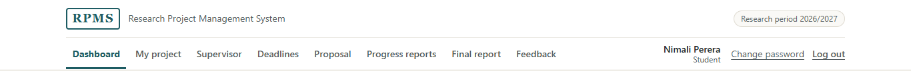

*Figure 2.1: Student header and navigation bar*

**Supervisor.** A supervisor looks after several students and mainly responds to things that students send. Their navigation (Figure 2.2) is short and organised around incoming work: Invitations, My students and Review queue. The two items that hold waiting work carry a count badge (here "1" and "4"). Each count also contains visually hidden text ("pending", "to review") so that a screen reader announces the meaning and not only the number.

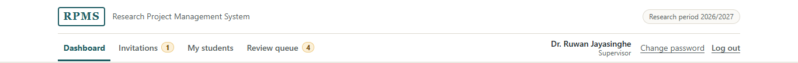

*Figure 2.2: Supervisor header and navigation bar with count badges*

**Academic Coordinator.** The coordinator administers the programme rather than individual projects. Their navigation (Figure 2.3) starts with the monitoring screens (Projects, Users) and continues with the set-up screens in the order in which a new year is prepared: Research period, Deadlines, Guidelines, Milestones and Extensions.

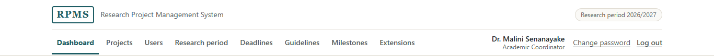

*Figure 2.3: Academic Coordinator header and navigation bar*

All three headers share the same structure: the RPMS brand mark, the active research period, the role navigation, and on the right the user's name and role with *Change password* and *Log out*. The current page is shown by an accent-coloured underline and a heavier font, marked in the code with `aria-current`, so the user always knows where they are. This follows the first of the lecture's "Four Pillars of UX", *keep navigation obvious* (University of Colombo School of Computing, 2026).

**No self-registration.** The log-in page has no "Register" link, unlike the generic log-in and register screen in the lecture's example blueprint. In RPMS, who may use the system is decided by the institution, not the user: only enrolled, eligible fourth-year students may create a project, and only academic staff may supervise. The coordinator therefore creates every account and gives it exactly one role (FR-04), and the log-in page says so ("Accounts are created by the Academic Coordinator"). This removes a whole class of errors, such as a student registering as a supervisor, and means that the eligibility flag on the Users screen (Section 2.5.4) can be trusted.

## 2.4 Main user flows

This section walks through the five flows that carry the revised workflow. Each step is a cropped screenshot of the real page in the relevant state. Where the sample data shows a different student at a step, I say so in the text; the screen and its controls are the same for every student.

### 2.4.1 Creating a project and getting a supervisor

1. **The student creates the project record.** On *My project* the student enters a working title, a research area and a brief description, and saves them (Figure 2.4). The project is in the Draft status and the side panel points to the next step, *Invite a supervisor*.

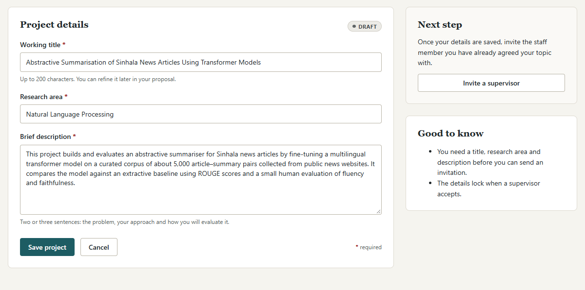

*Figure 2.4: Step 1 – the editable project record in the Draft status*

2. **The student invites a supervisor.** The invitation page lists registered academic staff as option cards with department and research areas, and offers a search by name or research area and a department filter (Figure 2.5). The student selects one supervisor, adds an optional message, and sends the invitation. A note beside the button says that the project status will change to *Awaiting supervisor*.

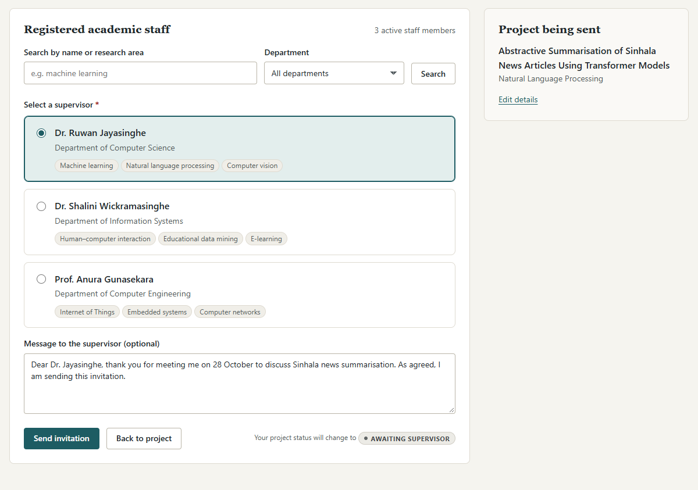

*Figure 2.5: Step 2 – choosing a supervisor and sending the invitation*

3. **The invitation is pending.** While the invitation is pending, the whole selection is disabled and the *Send invitation* button is disabled, with the reason printed beside it: "only one pending invitation is allowed at a time" (Figure 2.6). An information panel at the top of the page explains that a pending invitation cannot be cancelled.

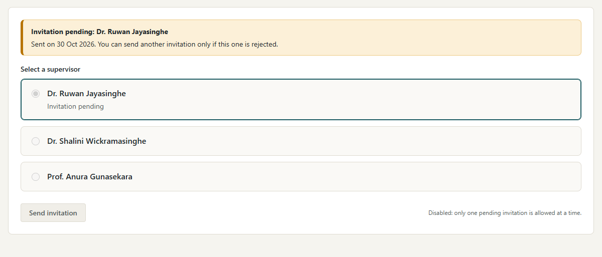

*Figure 2.6: Step 3 – sending is disabled while one invitation is pending*

4. **The supervisor responds.** The invited supervisor sees the invitation on their *Invitations* page with the student's title, research area, description and message, and how long it has been waiting (Figure 2.7). They can add an optional comment and choose *Accept and become supervisor* or *Reject*. The sample shows a different student's invitation; the card is the same for every invitation.

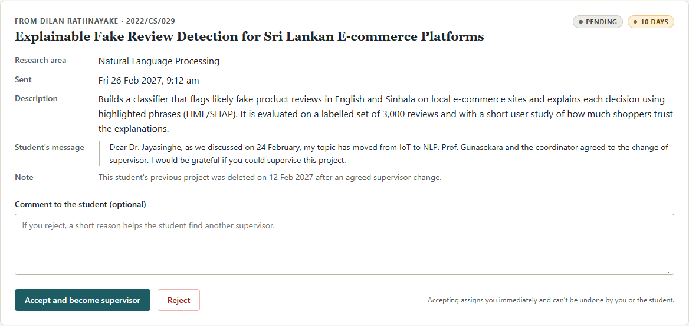

*Figure 2.7: Step 4 – the supervisor's pending invitation card with Accept and Reject*

5. **The invitation is rejected and the student invites someone else.** In the sample history, Prof. Gunasekara rejected the first invitation with the comment that the topic was outside his area. A rejection returns the project to Draft, so the student sees the editable record again (Figure 2.4) and the invitation form is enabled again (Figure 2.5). The student then invites Dr. Jayasinghe.

6. **The invitation is accepted.** When the second invitation is accepted, the invitation page shows a success message naming the supervisor and explaining that the supervisor can no longer be changed by the student. The invitation history shows both responses with their comments (Figure 2.8).

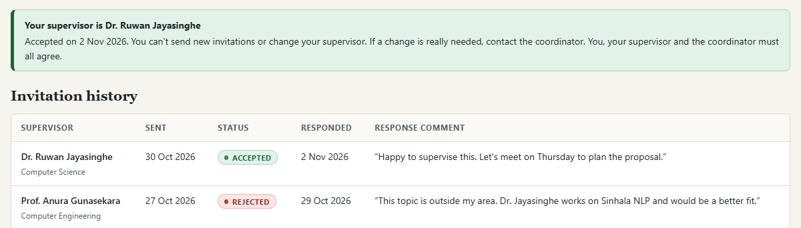

*Figure 2.8: Step 6 – supervisor assigned, with the rejected and accepted invitations in the history*

7. **The topic details lock.** On *My project* the fields become read-only, *Save project* is disabled, and a notice explains why and what to do if a change is really needed (Figure 2.9). The status history on the right records every step of this flow, including the rejection.

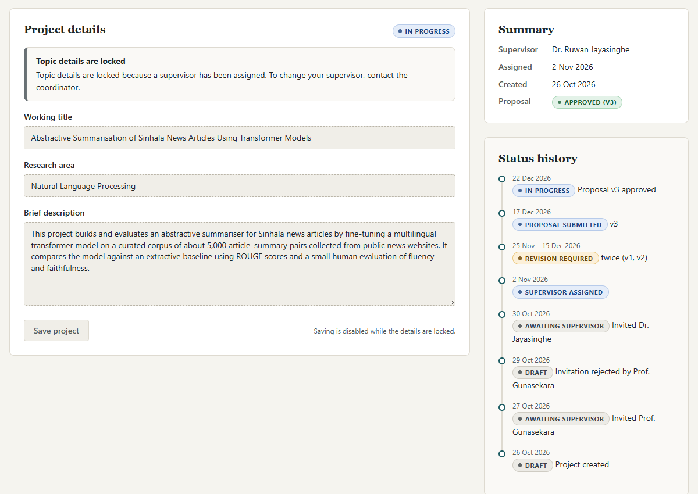

*Figure 2.9: Step 7 – topic details locked after the supervisor accepted, with the status history*

### 2.4.2 Proposal, revision and approval

1. **The supervisor requests a revision.** After the student submits a version, the supervisor opens it from the review queue and records a comment with one decision: *Comment only*, *Request revision* or *Approve* (Figure 2.10). A note under the decision explains the consequence of each choice. The sample shows the review of another student's proposal; the form is the same for every submission.

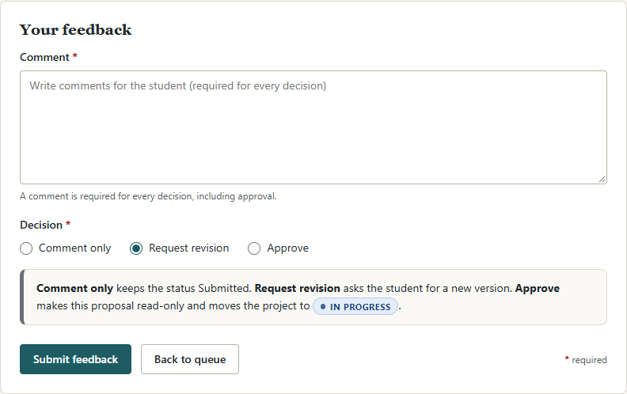

*Figure 2.10: Step 1 – the supervisor's feedback form with a required comment and one decision*

2. **The student reads the feedback.** The feedback is stored against the exact version it refers to and appears on the student's *Feedback* page with its decision badge (Figure 2.11).

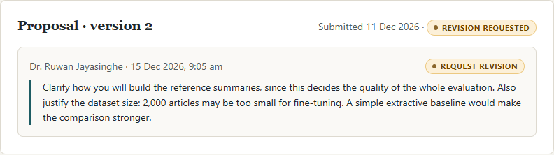

*Figure 2.11: Step 2 – the revision request, linked to proposal version 2*

3. **The student prepares and submits the revised version.** The proposal page shows the *Revision requested* status, the applicable hard deadline with the days left, and the form for version 3 (Figure 2.12). The version history and the latest feedback sit beside the form, so the student can address each comment without switching pages. The figure also shows the inline error that appears when the student chooses a file that is not a PDF or DOCX file, or is larger than 10 MB.

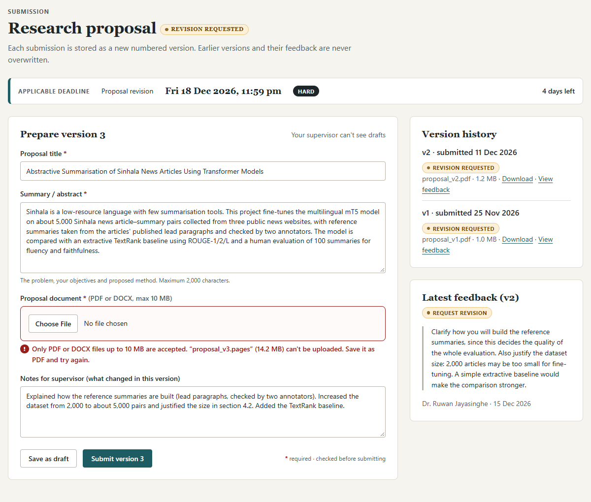

*Figure 2.12: Step 3 – preparing version 3 with the latest feedback beside the form*

4. **The supervisor approves.** The supervisor reviews version 3 on the same screen as Figure 2.10 and selects *Approve*. The proposal becomes read-only, and the project moves to *In progress* (Figure 2.13).

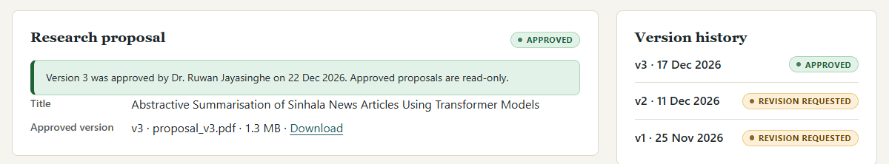

*Figure 2.13: Step 4 – the approved proposal, now read-only*

### 2.4.3 Progress report and review

1. **The student submits a progress report.** Once the project is in progress, the student fills in three guided fields: work completed, challenges or blockers, and planned next steps (Figure 2.14). They can link the report to a milestone that is not yet completed. The deadline banner shows the next soft deadline.

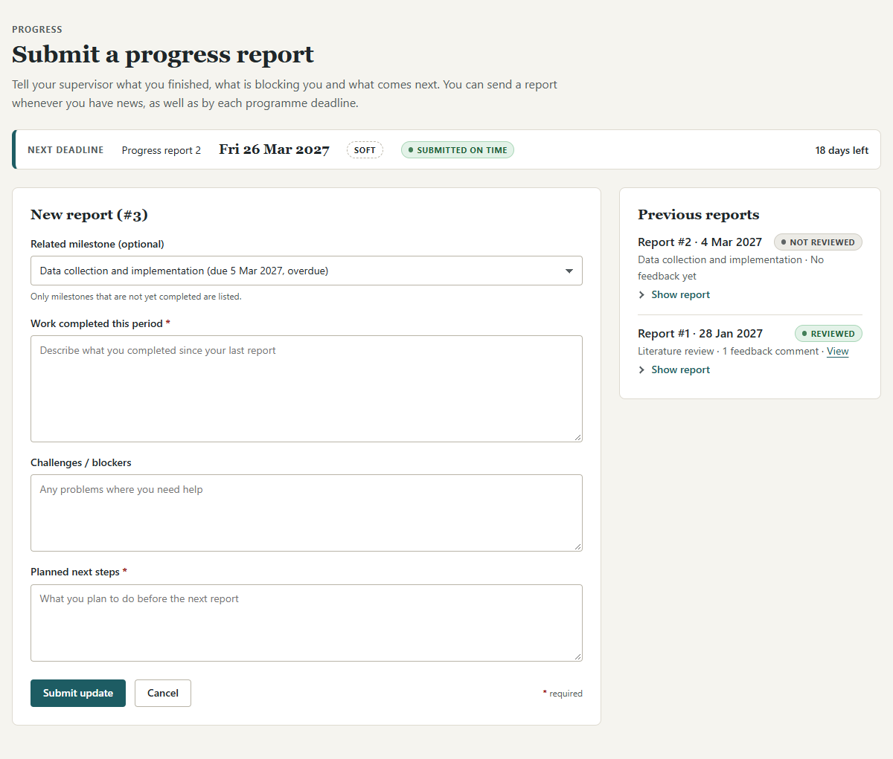

*Figure 2.14: Step 1 – submitting a progress report*

2. **The report appears in the supervisor's queue.** The review queue lists submitted items and unreviewed progress reports, oldest first, with how long each has been waiting and whether it arrived on time (Figure 2.15).

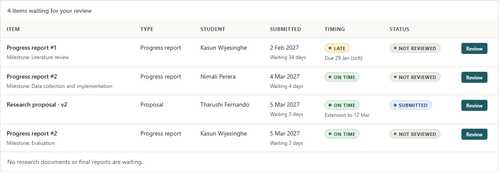

*Figure 2.15: Step 2 – the report waiting in the supervisor's review queue*

3. **The supervisor reviews it.** The review page shows the three parts of the report as read-only text, with a feedback form below it (Figure 2.16). The supervisor can save feedback only, or save it and mark the report as reviewed. Because the report refers to an overdue milestone, the same page lets the supervisor update the status of that milestone.

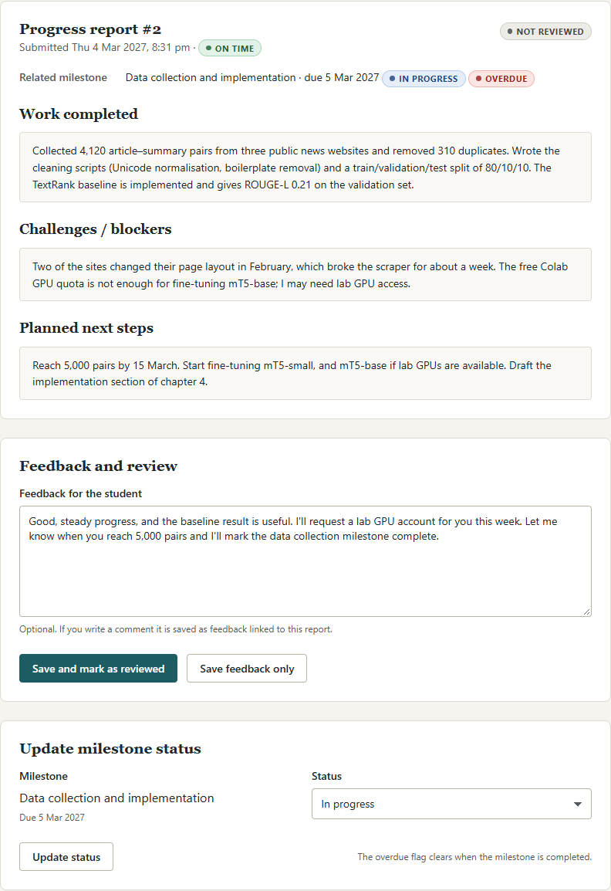

*Figure 2.16: Step 3 – reviewing the report and updating the related milestone*

4. **The student sees the outcome.** In the student's list of previous reports, each report shows *Reviewed* or *Not reviewed*, and can be expanded to show what was sent (Figure 2.17).

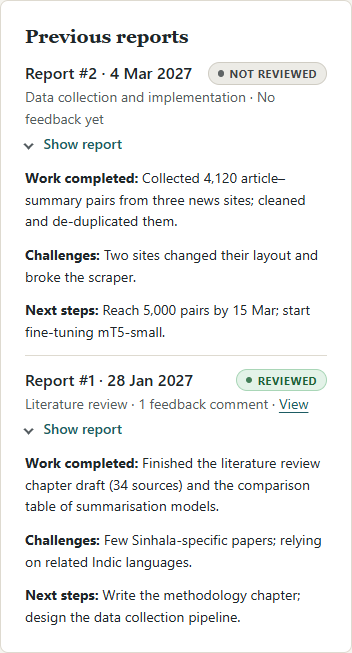{width=7}

*Figure 2.17: Step 4 – previous reports with their review status, expanded*

### 2.4.4 A hard deadline blocks submission and an extension is granted

1. **The student knows the deadline type in advance.** The *Deadlines* page lists every stage with its due date, its type (*Hard* or *Soft*) and the student's own status (Figure 2.18).

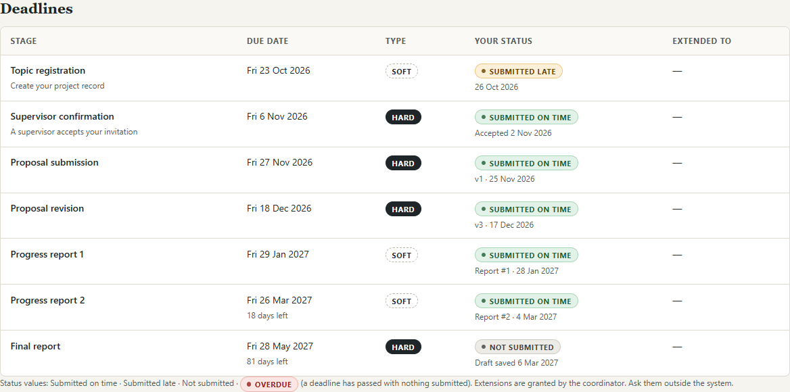

*Figure 2.18: Step 1 – published deadlines with their type and the student's status*

2. **Submission is blocked after a hard deadline.** If a hard deadline passes without an extension, the proposal page explains that submission is closed. *Submit version 3* is disabled, the deadline is printed beside it, and *Save as draft* still works, so no work is lost (Figure 2.19).

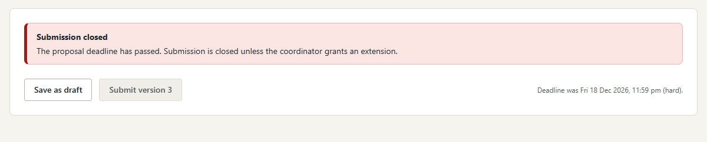

*Figure 2.19: Step 2 – submission closed after the hard deadline; saving a draft still works*

3. **The coordinator grants an extension.** Students request extensions outside the system. The coordinator records the extension by choosing the student and the deadline from lists, entering the new date and a required reason (Figure 2.20). A side panel explains how extensions affect hard and soft deadlines.

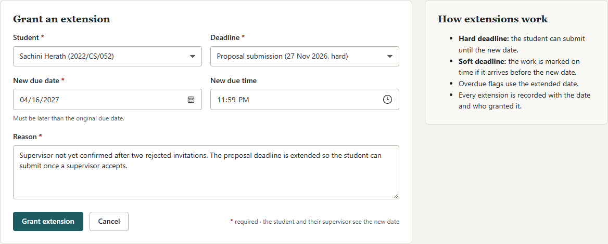

*Figure 2.20: Step 3 – the coordinator grants an extension to one student*

4. **The extension is recorded.** The extension appears in the list of granted extensions with the original and new dates, the reason, the date granted and its outcome (Figure 2.21). The extended date is also shown to the supervisor: in Figure 2.15 the proposal in the queue is marked "Extension to 12 Mar". The mock-ups do not yet show the student's own view of a granted extension (see Section 2.11).

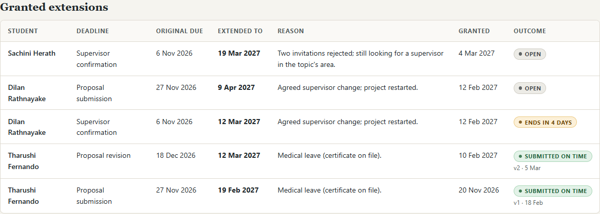

*Figure 2.21: Step 4 – the record of granted extensions*

### 2.4.5 Monitoring the programme and an agreed supervisor change

1. **The coordinator monitors the programme.** The dashboard opens with five counters (students without a supervisor, pending invitations, pending reviews, overdue activities and completed projects), a *Needs attention* list, projects by status, the next deadlines and recent activity (Figure 2.22).

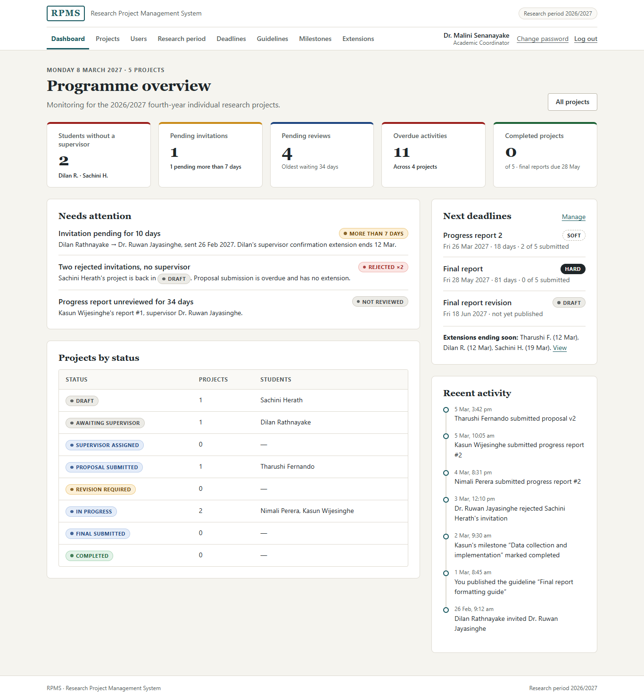

*Figure 2.22: Step 1 – the coordinator's programme overview*

2. **The coordinator opens the project list.** Projects can be searched and filtered by status, supervisor and overdue items. Projects without a supervisor are listed first and highlighted (Figure 2.23).

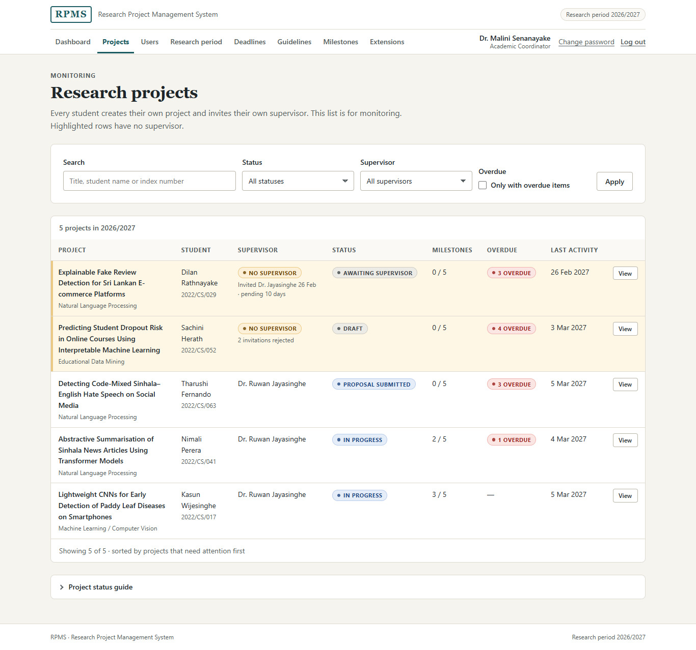

*Figure 2.23: Step 2 – the monitoring list of research projects*

3. **The coordinator opens a project.** The project detail page is read-only for the coordinator. Its side panel holds the two coordinator actions (Figure 2.24). *Mark as completed* is disabled until both listed conditions are met. *Delete project (agreed supervisor change)* explains that it may be used only when all three parties have agreed.

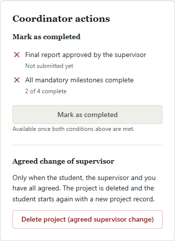{width=7}

*Figure 2.24: Step 3 – coordinator actions on the project detail page*

4. **The coordinator confirms the deletion.** The delete action opens a confirmation dialog (Figure 2.25). It names the student and the supervisor, explains exactly what will be removed and that the deletion will be recorded, and requires three separate confirmations (student agreed, supervisor agreed, coordinator approves) and a reason before *Delete project* can be submitted. *Cancel* closes the dialog without any change.

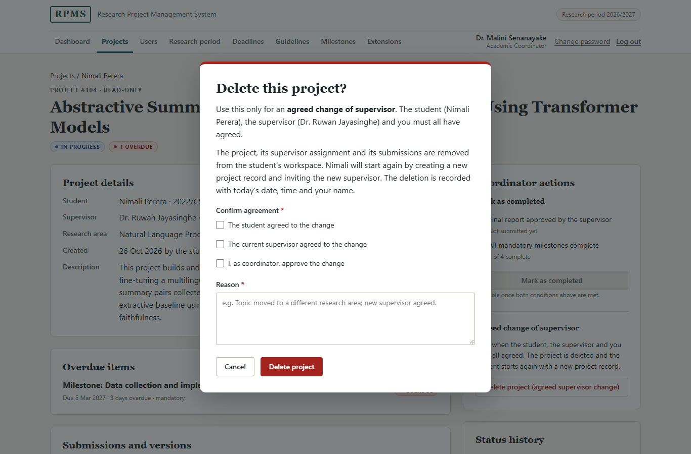

*Figure 2.25: Step 4 – the delete confirmation dialog for an agreed supervisor change*

## 2.5 Screen-by-screen design

This section describes every screen, grouped by role, in Figures 2.26 to 2.53. The full-page screenshots were taken at a width of 1366 pixels. On pages that show more than one state, the dashed "Mock-up state" labels separate the states; they are developer annotations and will be removed in the PHP views. Where a screen was already shown in Section 2.4, I refer to that figure.

### 2.5.1 Shared screens

#### Log in

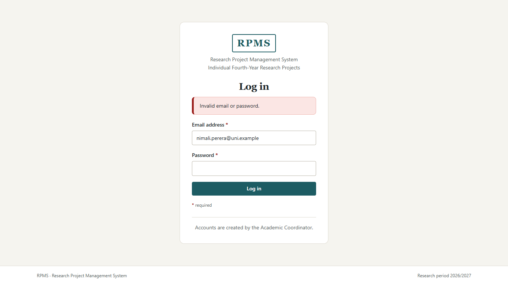

*Figure 2.26: Log in page*

**Purpose.** The log-in page authenticates a user by e-mail address and password (FR-01) and sends them to their role's dashboard.

**Controls.** An e-mail field (`type="email"`, so mobile keyboards show the @ key and the browser checks the format) and a password field, both required, and one full-width primary button. Both fields carry `autocomplete` values so password managers can fill them.

**Complexity.** This page is deliberately minimal: two fields, one button and one sentence. The lecture's newsletter example makes the point that a form should "only ask for what you actually need" (University of Colombo School of Computing, 2026), and logging in needs nothing else. There is no header navigation, because the user has no role until they log in.

**Layout.** A single centred card, with the brand at the top, then the heading, then the fields in reading order with their labels above them. This follows the "good UI" log-in in the lecture note, with labels outside the fields and aligned to a single column.

**States.** After a failed attempt, an error alert appears above the form: "Invalid email or password." It is deliberately generic and does not say which field was wrong, so that the page does not reveal which e-mail addresses are registered (Section 1.3.4).

#### Change password

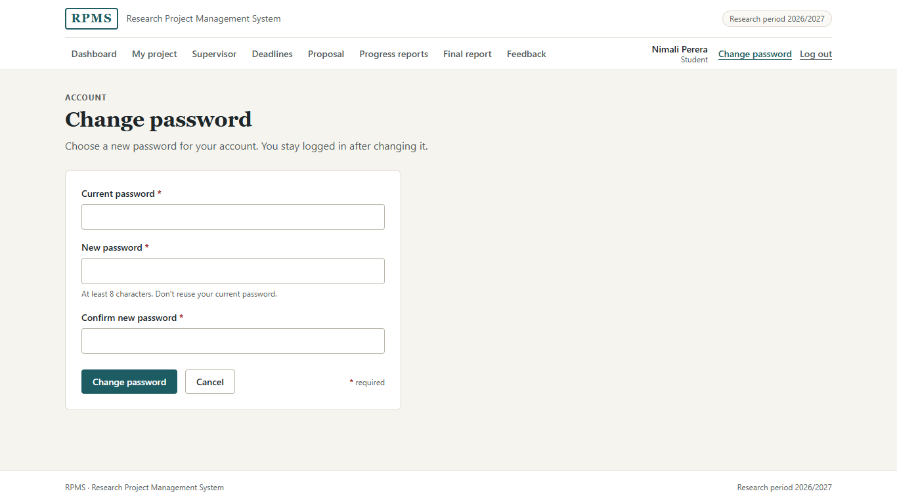

*Figure 2.27: Change password page*

**Purpose.** Any user can change their own password (FR-05). This matters because the coordinator gives each new user a temporary password.

**Controls.** Three password fields: current password, new password and confirmation. The two new-password fields require at least 8 characters (`minlength="8"`), and a hint states the rule before the user types.

**Layout and complexity.** A narrow single card, because a password form needs no side information. In the PHP version the page will use the header of whichever role is logged in; the mock-up shows the student header.

#### Permission denied (403)

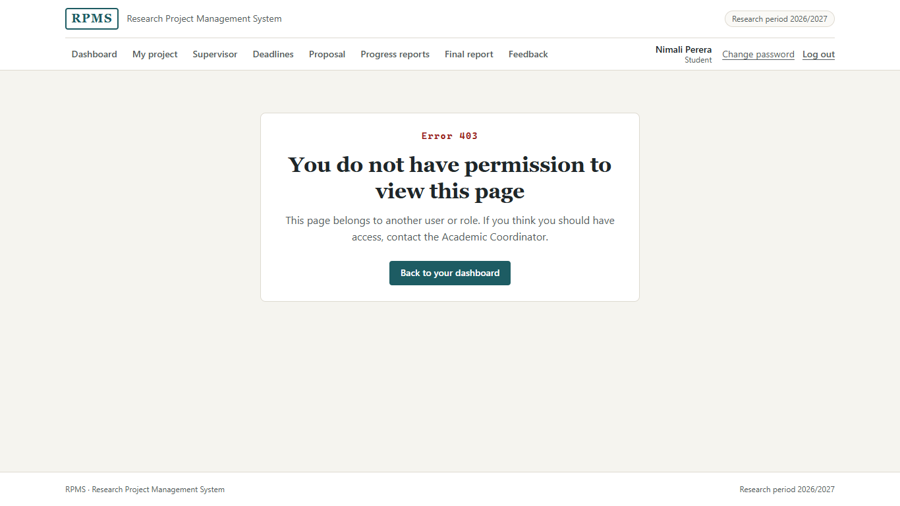

*Figure 2.28: Permission denied (403) page*

**Purpose.** This page appears when a user opens a page that belongs to another user or role, for example by editing a URL (FR-02, NFR-02).

**Design.** It states the error code, explains the problem in plain language ("This page belongs to another user or role"), tells the user who to contact, and offers one way back to their own dashboard. It shows no data from the requested page.

### 2.5.2 Student screens

#### Student dashboard

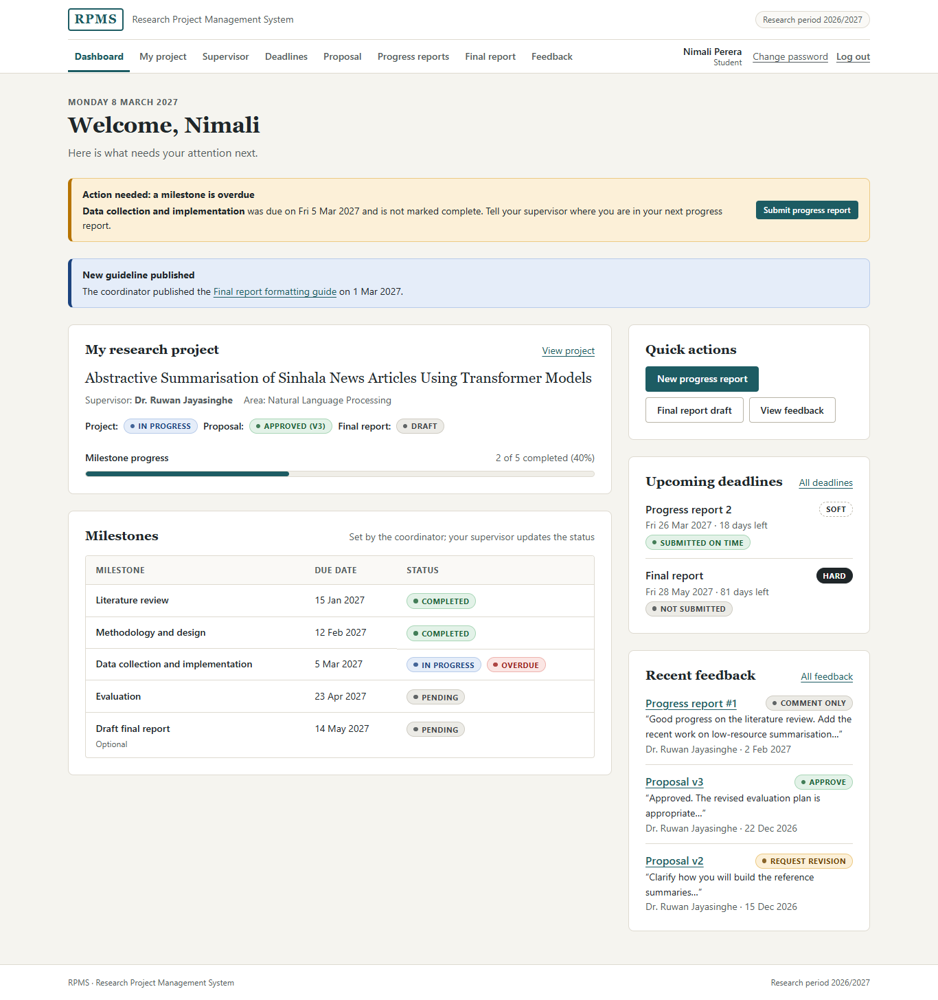

*Figure 2.29: Student dashboard*

**Purpose.** The dashboard answers "what do I need to do next?" (FR-26).

**Layout.** Information is ordered by urgency. Alerts come first and span the full width: a warning when a milestone is overdue, with a direct *Submit progress report* button, and an information notice when the coordinator publishes a new guideline. Below them, the main column shows *My research project* (title, supervisor, research area, and status badges for the project, the proposal and the final report, with a milestone progress bar) and the milestone table. The side panel holds quick actions, upcoming deadlines with their Hard or Soft type and days left, and the three most recent feedback items with their decision badges.

**Controls.** Links and buttons only; the dashboard is for orientation, not data entry. Each feedback item links to that exact item on the *Feedback* page.

**States.** Overdue milestones show both their status (*In progress*) and a separate *Overdue* badge, so the student can see that work has started but is late.

#### My research project

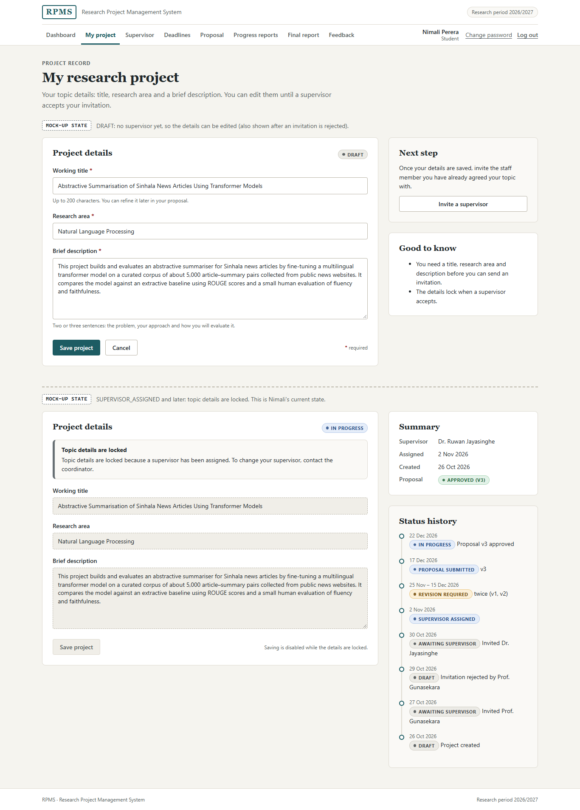

*Figure 2.30: My research project – Draft (editable) and locked states*

**Purpose.** The student creates and edits the project record (FR-06).

**Controls.** A single-line text field for the working title (up to 200 characters), a text field for the research area (up to 120 characters), and a tall text area for the brief description, because a description is several sentences long. A hint under each field gives guidance, for example "Two or three sentences: the problem, your approach and how you will evaluate it."

**Layout.** The form is in the main column; the side panel explains the next step and the rules ("The details lock when a supervisor accepts").

**States.** In the Draft status (Figure 2.4) the form is editable. After a supervisor accepts (Figure 2.9), the same fields are shown `readonly` with a dashed border and a sunken background, *Save project* is disabled with the reason beside it, and a notice explains that a change of supervisor needs the coordinator. I kept the locked fields as form fields, rather than replacing them with plain text, so the student sees the same page in both states and can still select and copy the text.

#### Invite a supervisor

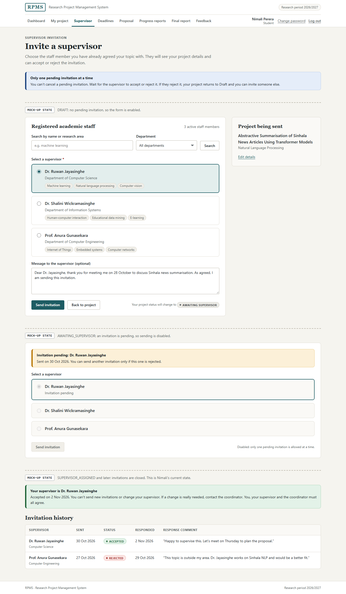

*Figure 2.31: Invite a supervisor – available, pending and assigned states with the invitation history*

**Purpose.** The student invites one supervisor and follows the response.

**Controls.**
- A search field and a department select narrow the staff list. They submit with GET, because they only filter and change nothing.
- Supervisors are offered as **radio buttons** presented as option cards. A radio button fits because exactly one supervisor must be chosen, and the whole card is the clickable label, so the department and research areas can be read before choosing. The selected card is highlighted with the accent colour.
- An optional message text area (up to 1,000 characters) with a placeholder suggesting what to write.

**Complexity.** The page is more complex than *My project* because it combines a choice, a strict rule and a history. The rule ("only one pending invitation at a time; you can't cancel it") is stated at the top before the user acts, so they understand the consequence before they press *Send invitation*.

**States.** Available (Figure 2.5), pending with everything disabled and the reason given (Figure 2.6), and assigned with a success message (Figure 2.8). The invitation history table is shown in every state.

#### Deadlines and guidelines

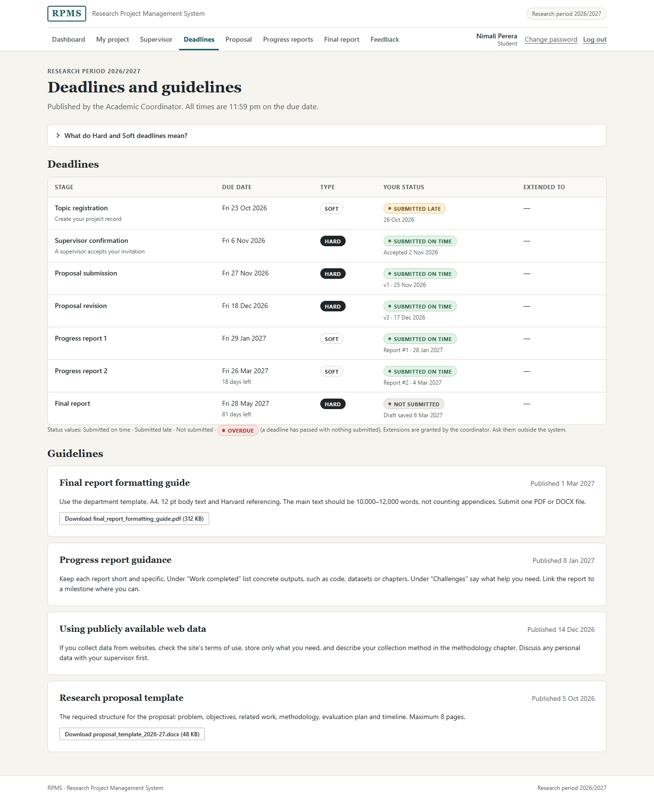

*Figure 2.32: Deadlines and guidelines (student view)*

**Purpose.** The student reads the deadlines and guidelines published by the coordinator.

**Layout.** A table lists every stage with its due date, its type and the student's own status (*Submitted on time*, *Submitted late*, *Not submitted* or *Overdue*), and an *Extended to* column. The guidelines follow as cards, each with a publication date and, where there is one, a download button that names the file and its size.

**Help.** The meaning of Hard and Soft is given in a disclosure at the top of the page (Figure 2.33). It is closed by default because the student needs it once, not every visit.

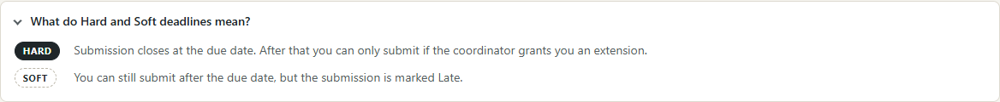

*Figure 2.33: The "What do Hard and Soft deadlines mean?" disclosure, opened*

#### Research proposal

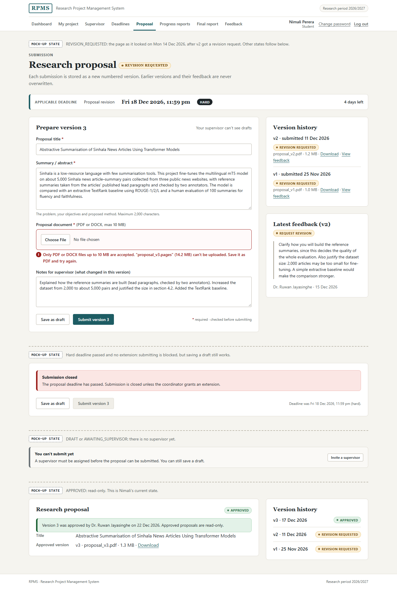

*Figure 2.34: Research proposal – all states*

**Purpose.** The student prepares, saves, submits and revises the proposal (UC-01, UC-03).

**Controls.**
- A text field for the proposal title (up to 200 characters).
- A text area for the summary (up to 2,000 characters; the limit is stated in the hint).
- A **file input** restricted by `accept` to PDF and DOCX, inside a dashed drop area. The label itself states "(PDF or DOCX, max 10 MB)", so the rule is visible before the user chooses a file.
- An optional text area for notes to the supervisor on what changed.
- Two separate buttons, *Save as draft* (secondary) and *Submit version 3* (primary). They share one form but send different `intent` values, so the user makes an explicit choice and the more consequential action carries the stronger visual weight. The version number on the button tells the student exactly what they are about to create.

**Complexity.** This is one of the most complex student screens because it serves both the first submission and every resubmission. To avoid making the student remember earlier comments, the version history and the latest feedback are placed beside the form (recognition rather than recall; Nielsen, 1994).

**States.** Revision requested with an inline error (Figure 2.12); submission closed after a hard deadline (Figure 2.19); approved and read-only (Figure 2.13); and no supervisor yet (Figure 2.35), where submission is unavailable but saving a draft still works.

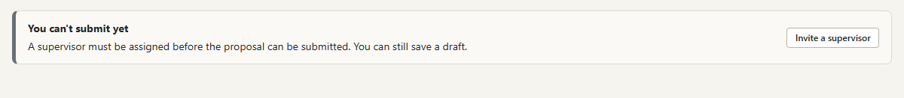

*Figure 2.35: Proposal page before a supervisor is assigned*

#### Progress reports

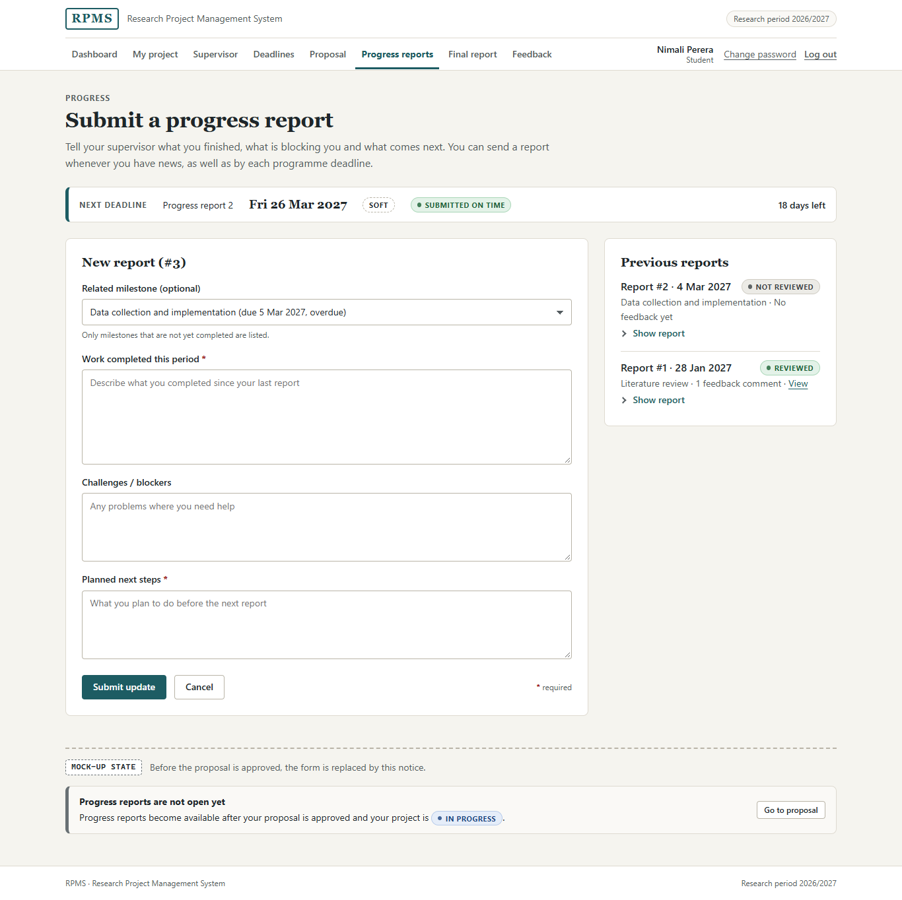

*Figure 2.36: Progress reports*

**Purpose.** The student reports progress so that the supervisor can respond to problems early (FR-24, UC-04).

**Controls.**
- A **select** for the related milestone, because the choice is from a short, known list. The first option is "No specific milestone", which makes the link optional. Only milestones that are not yet completed are listed, and each option includes its due date and, where relevant, "overdue".
- Three text areas instead of one free-text box: work completed (required), challenges or blockers (optional) and planned next steps (required). The guided structure, kept from Figure 1.11, makes reports consistent and easier to review.
- *Submit update* and *Cancel*.

**Layout.** The form is in the main column; previous reports are in the side panel with their review status. Each report can be expanded with a `
` disclosure (Figure 2.17), so the side panel stays short.

**States.** Before the proposal is approved, the form is replaced by a notice that progress reports are not open yet, with a link to the proposal (Figure 2.37).

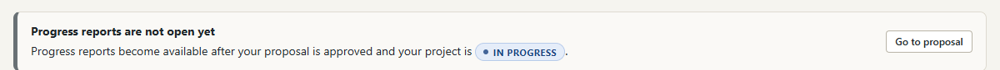

*Figure 2.37: Progress reports before the project is in progress*

#### Final report

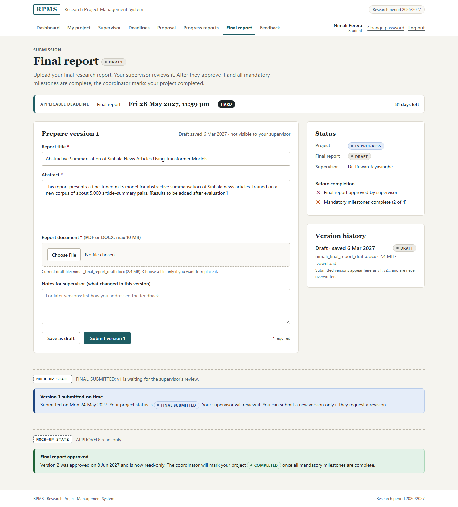

*Figure 2.38: Final report – draft, submitted and approved states*

**Purpose.** The student uploads the final research report for the supervisor's review.

**Controls.** The same pattern as the proposal (title, abstract, file input, change notes, *Save as draft* and *Submit version 1*). Using the same pattern means a student who has submitted a proposal already knows how to submit the final report (consistency and standards; Nielsen, 1994). The hint under the file input names the current draft file and its size.

**Layout.** The side panel shows the status of the project and the report, and a "Before completion" checklist: final report approved by the supervisor, and mandatory milestones complete (2 of 4). It tells the student in advance what still stands between them and completion.

**States.** Draft; submitted and waiting for review; and approved and read-only, each with its own message.

#### Feedback

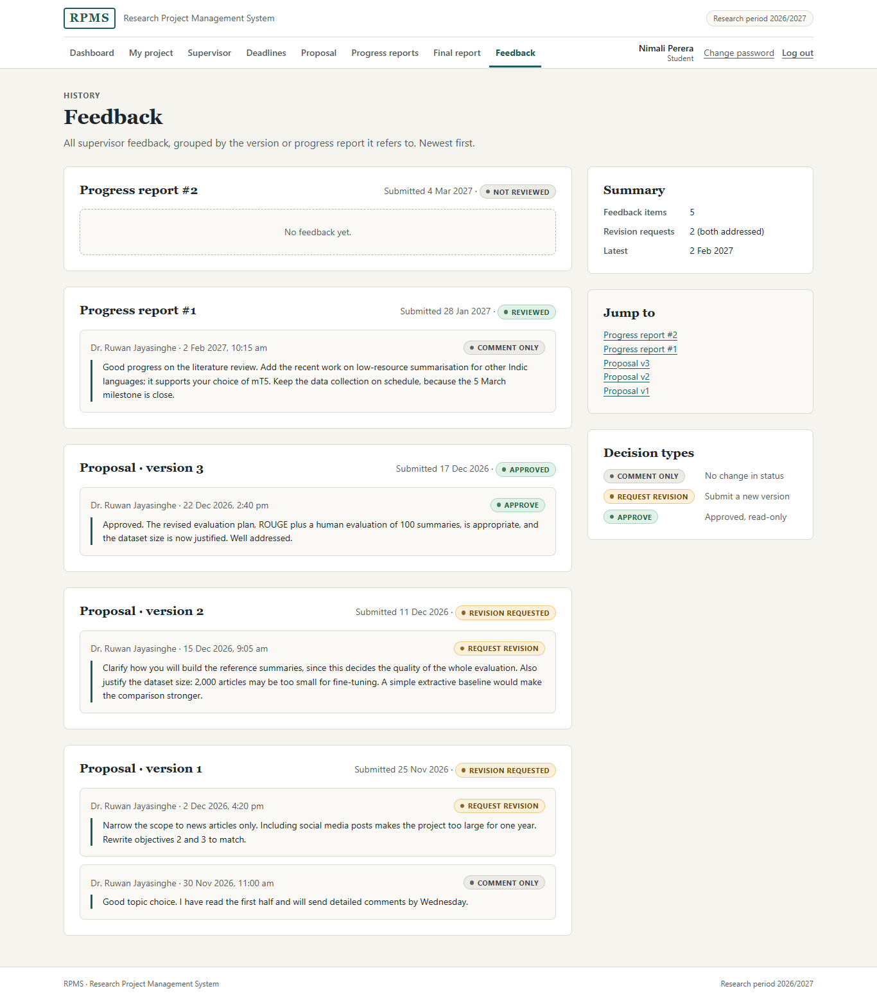

*Figure 2.39: Feedback history*

**Purpose.** The student reads all feedback, grouped by the version or progress report it refers to (FR-20).

**Layout.** One card per version or report, newest first. Each card shows the submission date and status, then each feedback item with the supervisor's name, date and time, and its decision badge. A report with no feedback yet shows an empty state ("No feedback yet."). The side panel gives a summary, "Jump to" links, and a legend of the three decision types.

**Controls.** Links only; feedback cannot be edited (NFR-11). Each card has an `id`, so the dashboard and the proposal page can link straight to the relevant feedback.

### 2.5.3 Supervisor screens

#### Supervisor dashboard

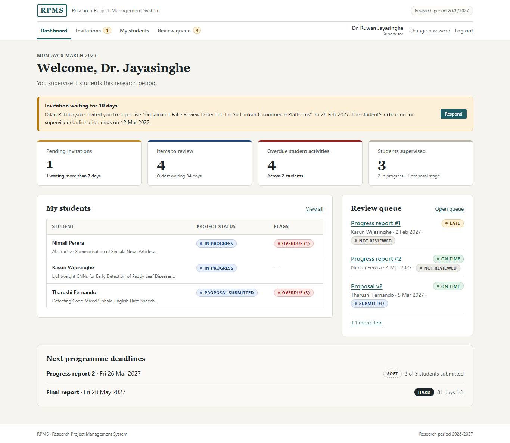

*Figure 2.40: Supervisor dashboard*

**Purpose.** It shows the supervisor everything waiting for them (FR-26).

**Layout.** An alert at the top draws attention to an invitation that has waited for ten days and to the student's extension that is about to end, with a *Respond* button. Four stat tiles follow (pending invitations, items to review, overdue student activities, students supervised). Each tile is a link to the page that resolves it, and each has a coloured top border that matches its urgency. Below them are the *My students* table with flags, a short review queue, and the next programme deadlines.

#### Invitations

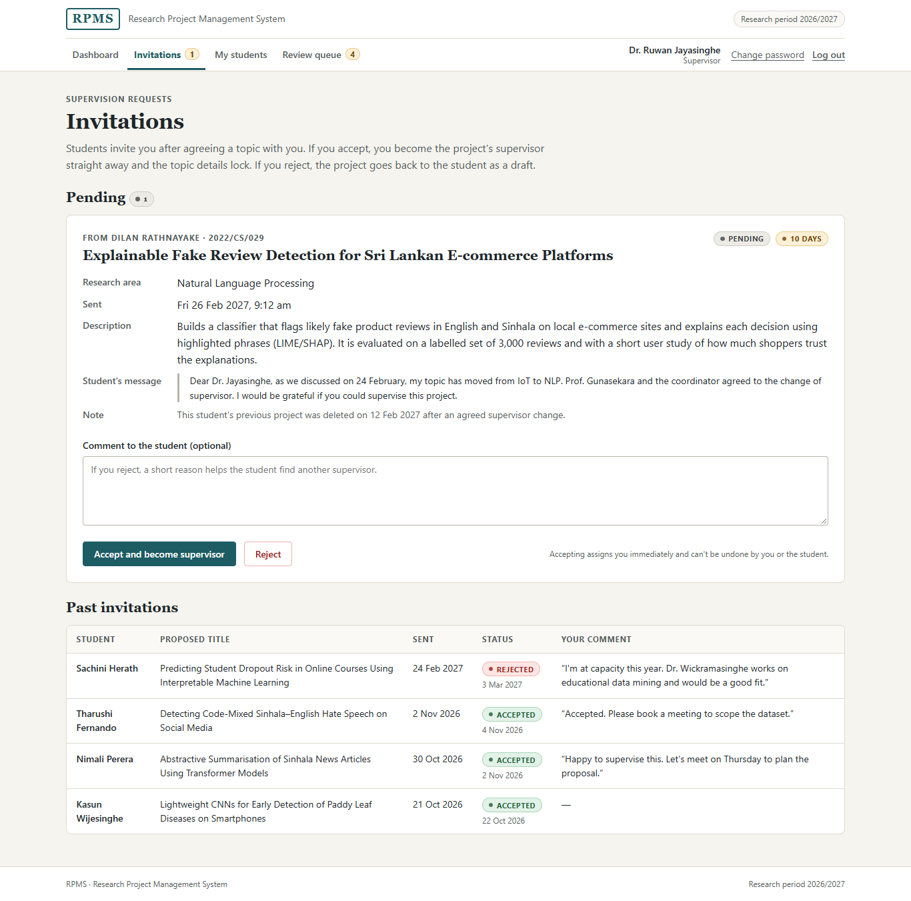

*Figure 2.41: Supervisor invitations*

**Purpose.** The supervisor accepts or rejects requests to supervise.

**Controls.** One optional comment text area and two submit buttons, *Accept and become supervisor* (primary) and *Reject* (danger outline). I used two buttons rather than radio buttons and a submit button because the decision is a single, immediate action with only two outcomes, and each button names its outcome. The placeholder suggests giving a reason when rejecting, because it helps the student find another supervisor.

**Layout.** Each pending invitation is a card that holds everything needed to decide without opening another page: student and index number, proposed title, research area, description, the student's message, and how long it has been waiting. The page introduction and a note beside the buttons state that accepting assigns the supervisor immediately and cannot be undone by the supervisor or the student.

**States.** Pending invitations, and a table of past invitations with the status, response date and the supervisor's own comment.

#### My students

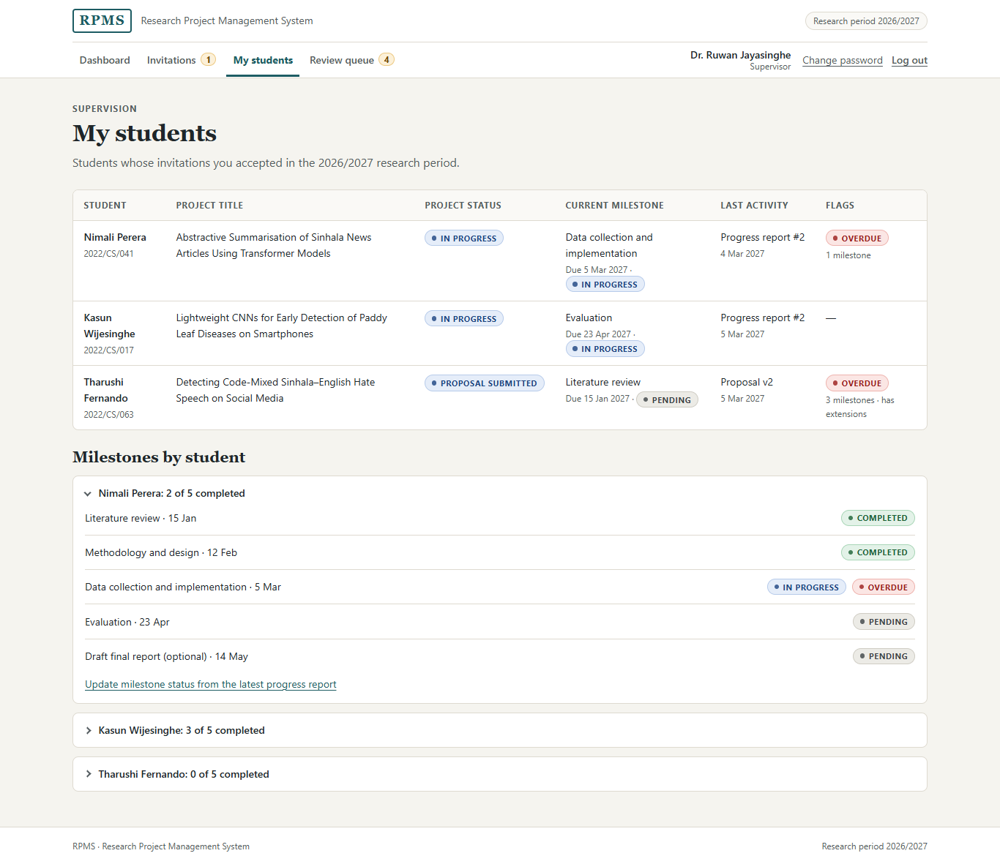

*Figure 2.42: My students*

**Purpose.** The supervisor follows each student's status and milestones (FR-22, FR-23).

**Layout.** A table lists each student with project title, status, current milestone, last activity and flags such as *Overdue*. Below it, each student's milestones are in a `
` disclosure whose summary shows the count, for example "Nimali Perera: 2 of 5 completed". The first is open by default. This keeps a long list scannable while still giving the detail on demand.

#### Review queue

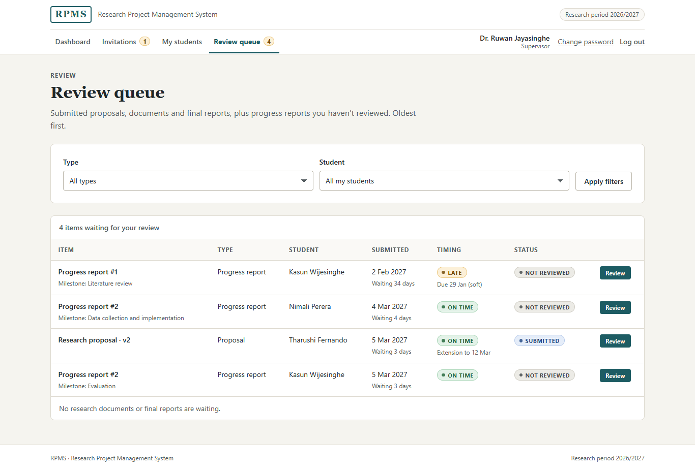

*Figure 2.43: Review queue*

**Purpose.** It lists submitted items and unreviewed progress reports for the supervisor's own students (FR-17).

**Controls.** Two **selects** filter by type and by student, because both are known short lists. They submit with GET, so a filtered queue can be bookmarked or refreshed without resubmitting a form.

**Layout.** The table is sorted oldest first, so the item that has waited longest is at the top. Each row shows how long it has waited, whether it arrived on time (with the deadline type, or the extension date), its status, and a *Review* button. The table caption gives the total, and a footnote states which item types have nothing waiting, so an empty category is not mistaken for a loading problem.

#### Review submission

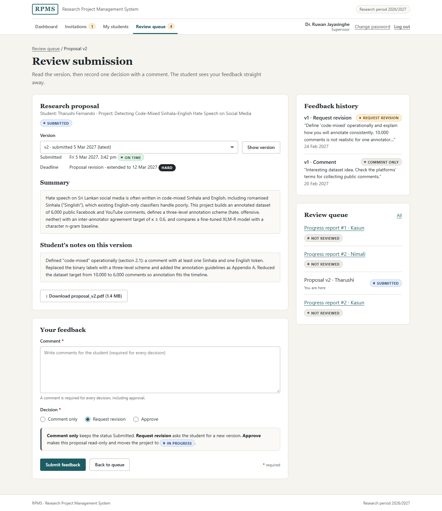

*Figure 2.44: Review submission*

**Purpose.** The supervisor reviews one version and records feedback with one decision (UC-02, FR-18).

**Controls.**
- A **select** to choose the version, because a submission has a known list of versions and the latest is selected by default.
- Read-only text blocks for the summary and the student's notes, and a download button that names the file and its size.
- A required comment text area. A hint states that a comment is required for every decision, including approval.
- Three **radio buttons** for the decision: *Comment only*, *Request revision* and *Approve*. Radio buttons fit because exactly one decision is required and all three options should be visible at once for comparison.
- A neutral note directly under the decision explains what each option will do, including that approval makes the proposal read-only and moves the project to *In progress*.

**Complexity and layout.** This is the most complex supervisor screen, because a good decision depends on context. The submission and the feedback form are in the main column, and the full feedback history for earlier versions is beside them, so the supervisor can check whether earlier comments were addressed without remembering them. A breadcrumb and a short queue in the side panel let the supervisor move to the next item without returning to the queue.

#### Review progress report

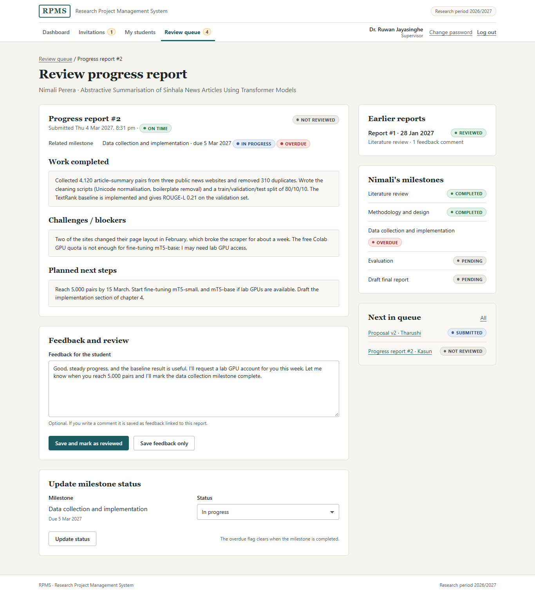

*Figure 2.45: Review progress report*

**Purpose.** The supervisor reviews a progress report, adds feedback and marks it as reviewed (FR-25), and can update the related milestone (FR-22).

**Controls.**
- An optional feedback text area. Unlike a submission review, a progress report has no decision, so the comment is optional and the hint says so.
- Two buttons: *Save and mark as reviewed* and *Save feedback only*.
- A separate small form with a **select** for the milestone status (Pending, In progress, Completed), a known list of three values. A note explains that the overdue flag clears when the milestone is completed.

**Layout.** The three parts of the report follow the same headings the student filled in, so the supervisor reads them in the order they were written. The side panel shows earlier reports, the student's milestones and the next items in the queue.

### 2.5.4 Academic Coordinator screens

#### Programme overview (dashboard)

The coordinator dashboard is shown in Figure 2.22. Its purpose is to give early warning of stalled work (FR-26). The five stat tiles count the problems that need the coordinator's attention, and each links to the project list. The *Needs attention* list explains each problem in a sentence, for example an invitation pending for ten days whose extension ends on 12 March. The *Projects by status* table lists all eight statuses, including those with no projects, so the coordinator sees the whole lifecycle at once. The side panel lists the next deadlines (including one still in draft), extensions that end soon, and a timeline of recent activity.

#### Research period

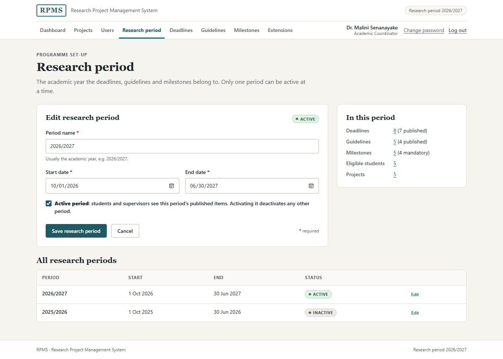

*Figure 2.46: Research period*

**Purpose.** The coordinator sets the academic year to which deadlines, guidelines and milestones belong.

**Controls.** A text field for the period name (up to 40 characters), two **date inputs** for the start and end dates (a date picker prevents badly formatted dates), and a **checkbox** for *Active period*. A checkbox fits because the setting is a single on/off choice; its label explains the side effect that activating it deactivates any other period.

**Layout.** The form is in the main column; the side panel counts what belongs to the period, with links. A table of all periods follows.

#### Deadlines

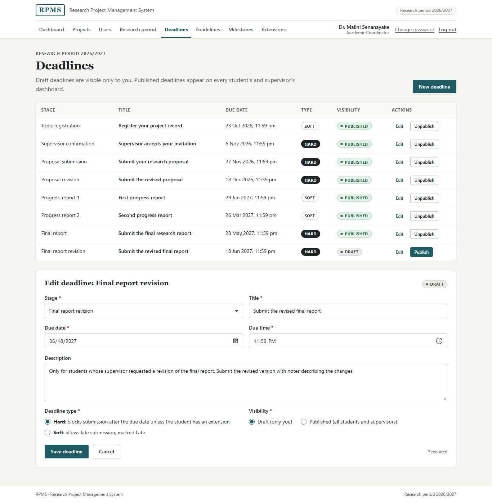

*Figure 2.47: Deadlines (coordinator)*

**Purpose.** The coordinator creates, edits and publishes deadlines.

**Controls.**
- A **select** for the stage, because the stages are a fixed list.
- Text field for the title, **date** and **time** inputs for the due date and time, and an optional description.
- Two groups of **radio buttons**: deadline type (*Hard* or *Soft*) and visibility (*Draft* or *Published*). Each is a single required choice between two options. Each type option has a label that explains its effect, for example "Hard: blocks submission after the due date unless the student has an extension", so the coordinator does not need to remember the rule.
- In the table, each row has an *Edit* link and a one-button form to *Publish* or *Unpublish*.

**States.** Draft deadlines carry a neutral *Draft* badge and a primary *Publish* button; published deadlines carry a green *Published* badge.

#### Guidelines

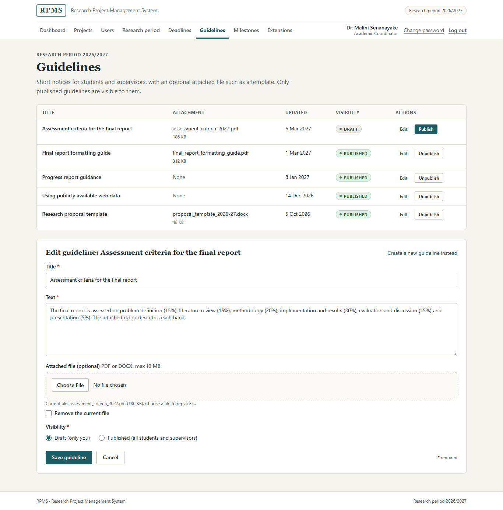

*Figure 2.48: Guidelines (coordinator)*

**Purpose.** The coordinator publishes short notices with an optional attached file such as a template.

**Controls.** Title and text (both required), an optional **file input** restricted to PDF and DOCX, a **checkbox** to remove the current file, and visibility **radio buttons**. The hint under the file input names the current file, so the coordinator knows what will be replaced.

#### Extensions

The extensions screen is shown in Figures 2.20 and 2.21. The student and the deadline are **selects** because both come from known lists. Each deadline option includes its date and type, for example "Proposal submission (27 Nov 2026, hard)", so the coordinator can check that they have the right one. The new date uses a **date input** with a hint ("Must be later than the original due date"), the new time is an optional **time input**, and the reason is a required text area of up to 500 characters, because every extension must be explainable later. The side panel explains how extensions affect hard and soft deadlines and overdue flags.

#### Programme milestones

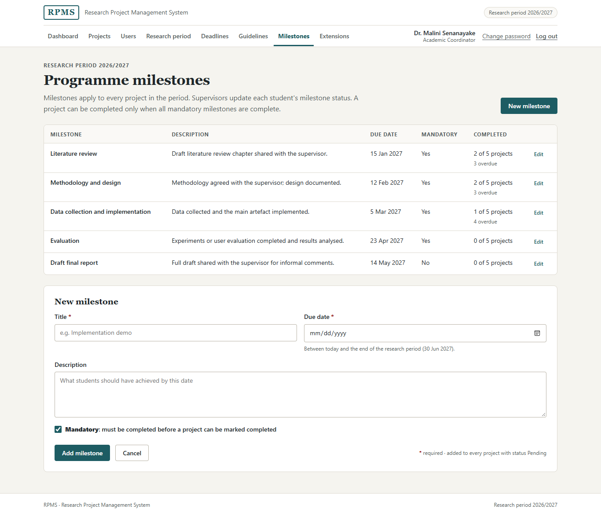

*Figure 2.49: Programme milestones*

**Purpose.** The coordinator defines the milestones that apply to every project in the period (a revision of FR-21; see Section 2.7).

**Controls.** Title (required), a **date input** limited by `min` and `max` to the range between today and the end of the period (the hint states the range), an optional description, and a **checkbox** for *Mandatory*, whose label explains that a mandatory milestone must be completed before a project can be marked completed.

**Layout.** The table shows each milestone with its due date, whether it is mandatory, and how many projects have completed it and how many are overdue. The coordinator can therefore see programme-wide slippage at a glance.

#### Users

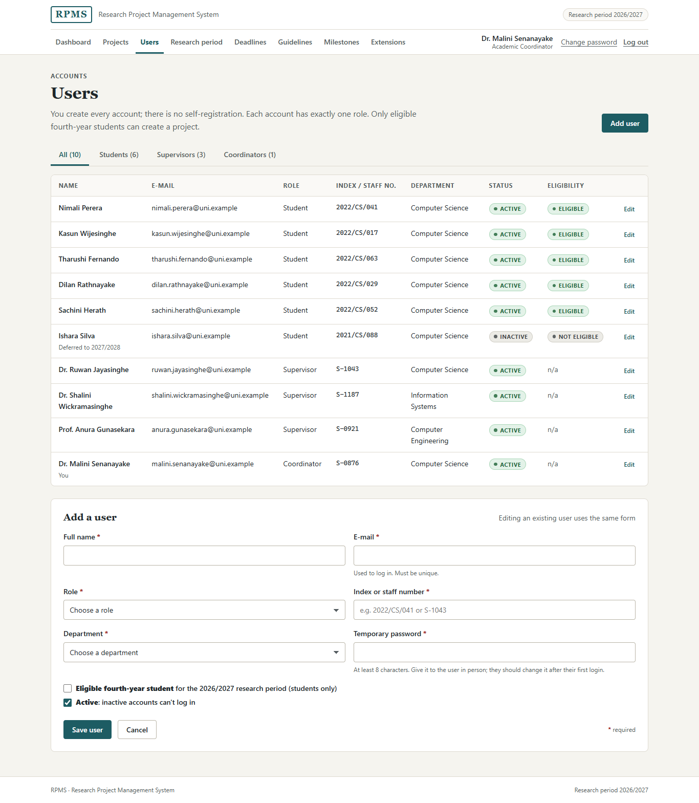

*Figure 2.50: Users – all users and the add-user form*

**Purpose.** The coordinator creates and edits every account and assigns one role (FR-04).

**Controls.**
- **Tabs** filter the table by role (Figure 2.51). They work without JavaScript through the CSS `:target` selector, and each tab is a plain link that a PHP version can turn into a query string.
- The form uses text fields for the full name and the index or staff number, an **e-mail** field (with a hint that it is the log-in name and must be unique), **selects** for the role and the department, and a **password** field for the temporary password with a minimum length of 8.
- Two **checkboxes**: *Eligible fourth-year student* (students only) and *Active*. Each is an independent yes/no setting, and the *Active* label explains that inactive accounts cannot log in.

**States.** Inactive and not-eligible users carry neutral badges, and a deferred student shows the reason under their name.

*Figure 2.51: Users – the Students tab selected through :target*

#### Research projects

The project list is shown in Figure 2.23. It is a **monitoring** screen: the introduction states that every student creates their own project and invites their own supervisor. The search field and three filters (status **select**, supervisor **select** including "No supervisor", and an "Only with overdue items" **checkbox**) submit with GET. Projects without a supervisor are sorted first and highlighted with a pale amber background and a left bar. Because colour must not be the only signal, each also carries a *No supervisor* badge and a line explaining the situation, for example "2 invitations rejected". A *Project status guide* disclosure under the table explains all eight statuses (Figure 2.52).

*Figure 2.52: The project status guide, opened*

#### Project detail

*Figure 2.53: Project detail (coordinator)*

**Purpose.** The coordinator inspects one project, marks it completed (FR-09) or deletes it after an agreed supervisor change.

**Layout.** The page is read-only for the coordinator. The main column shows project details, overdue items, all submissions and versions with their timing and decisions, milestones and the invitation history. A hint states that the coordinator sees statuses and dates only, because the supervisor reviews the content. The side panel holds the coordinator actions and the status history.

**States and controls.** *Mark as completed* is a disabled primary button. The two conditions it waits for are listed above it with cross marks and their current values, and the button is linked to them with `aria-describedby`, so the reason is announced as well as shown. *Delete project* is a danger-outline link, styled so that it is clearly different from the primary action. It opens the confirmation dialog (Figure 2.25), which contains three required **checkboxes**, one for each party's agreement, and a required reason. I used three checkboxes rather than one, because each records a separate fact that the coordinator must confirm.

## 2.6 Controls and validation

Table 2.6 lists every input on every form, taken from the HTML attributes in the code. Hidden inputs that carry record identifiers and the `csrf_token` field on every state-changing form are not listed. "Browser message" means that the markup relies on the browser's built-in message (for example "Please fill out this field"); no custom message exists in the mock-up for that field.

Table 2.6: Form controls and their validation

| Screen | Field (`name`) | Control | Req. | Validation rule in HTML | Error message shown | Business rule |
|---|---|---|---|---|---|---|
| Log in | `email` | E-mail field | Yes | `type="email"`, `required` | "Invalid email or password." (after a failed attempt) | FR-01; message does not reveal which field was wrong |
| Log in | `password` | Password field | Yes | `required` | As above | FR-01 |
| Change password | `current_password` | Password field | Yes | `required` | Browser message | FR-05 |
| Change password | `new_password` | Password field | Yes | `required`, `minlength="8"` | Browser message; hint states the rule | At least 8 characters; not the current password |
| Change password | `confirm_password` | Password field | Yes | `required`, `minlength="8"` | Browser message | Must match the new password (not checked in HTML) |
| My project | `title` | Text field | Yes | `required`, `maxlength="200"` | Browser message | FR-06; editable only before a supervisor is assigned |
| My project | `research_area` | Text field | Yes | `required`, `maxlength="120"` | Browser message | FR-06 |
| My project | `description` | Text area | Yes | `required` | Browser message | FR-06 |
| Invite a supervisor | `q` | Search field (GET) | No | `type="search"` | – | Filter only |
| Invite a supervisor | `department` | Select (GET) | No | – | – | Filter only |
| Invite a supervisor | `supervisor_id` | Radio buttons | Yes | `required` | Browser message | One pending invitation; only active supervisors |
| Invite a supervisor | `message` | Text area | No | `maxlength="1000"` | – | – |
| Proposal | `title` | Text field | Yes | `required`, `maxlength="200"` | Browser message | FR-10 |
| Proposal | `summary` | Text area | Yes | `required`, `maxlength="2000"` | Browser message; hint states the limit | FR-10 |
| Proposal | `proposal_file` | File input | Yes | `required`, `accept=".pdf,.docx,…"` (extensions and MIME types) | "Only PDF or DOCX files up to 10 MB are accepted. … Save it as PDF and try again." | FR-14, NFR-06; 10 MB limit |
| Proposal | `change_notes` | Text area | No | `maxlength="1000"` | – | FR-15 (notes on a revised version) |
| Proposal | `intent` | Two submit buttons | – | `value="draft"` / `"submit"` | Submit disabled with reason when blocked | FR-11; supervisor assigned; hard deadline |
| Progress reports | `milestone_id` | Select | No | – | – | FR-24; only milestones not completed |
| Progress reports | `work_completed` | Text area | Yes | `required` | Browser message | UC-04 step 6 |
| Progress reports | `challenges` | Text area | No | – | – | – |
| Progress reports | `next_steps` | Text area | Yes | `required` | Browser message | UC-04 step 6 |
| Final report | `title` | Text field | Yes | `required`, `maxlength="200"` | Browser message | – |
| Final report | `summary` | Text area | Yes | `required`, `maxlength="2000"` | Browser message | – |
| Final report | `report_file` | File input | Yes | `required`, `accept=".pdf,.docx,…"` | Browser message | 10 MB limit; PDF or DOCX |
| Final report | `change_notes` | Text area | No | `maxlength="1000"` | – | – |
| Invitations (supervisor) | `response_comment` | Text area | No | `maxlength="1000"` | – | – |
| Invitations (supervisor) | `status` | Two submit buttons | – | `value="ACCEPTED"` / `"REJECTED"` | – | Only the invited supervisor; only a pending invitation |
| Review queue | `type`, `student_id` | Selects (GET) | No | – | – | Own students only |
| Review submission | `version_id` | Select (GET) | No | – | – | – |
| Review submission | `comment` | Text area | Yes | `required` | Browser message; hint states the rule | Comment required for every decision (UC-02 6c) |
| Review submission | `decision` | Radio buttons | Yes | `required` | Browser message | FR-18; one decision |
| Review progress report | `comment` | Text area | No | – | – | FR-25 |
| Review progress report | `action` | Two submit buttons | – | `value="mark_reviewed"` / `"comment"` | – | FR-25 |
| Review progress report | `status` | Select | – | – | – | FR-22; PENDING, IN_PROGRESS, COMPLETED |
| Research period | `name` | Text field | Yes | `required`, `maxlength="40"` | Browser message | – |
| Research period | `start_date`, `end_date` | Date inputs | Yes | `type="date"`, `required` | Browser message | End after start (not checked in HTML) |
| Research period | `is_active` | Checkbox | No | – | – | Only one active period |
| Deadlines | `stage` | Select | Yes | `required` | Browser message | – |
| Deadlines | `title` | Text field | Yes | `required`, `maxlength="150"` | Browser message | – |
| Deadlines | `due_date` | Date input | Yes | `type="date"`, `required` | Browser message | Within the research period (not checked in HTML) |
| Deadlines | `due_time` | Time input | Yes | `type="time"`, `required` | Browser message | – |
| Deadlines | `description` | Text area | No | `maxlength="1000"` | – | – |
| Deadlines | `deadline_type` | Radio buttons | Yes | `required` | Browser message | HARD blocks late submission; SOFT marks it late |
| Deadlines | `status` | Radio buttons | Yes | `required` | Browser message | Only PUBLISHED is visible to others |
| Guidelines | `title` | Text field | Yes | `required`, `maxlength="150"` | Browser message | – |
| Guidelines | `content` | Text area | Yes | `required` | Browser message | – |
| Guidelines | `attachment` | File input | No | `accept=".pdf,.docx,…"` | – | PDF or DOCX, 10 MB |
| Guidelines | `remove_attachment` | Checkbox | No | – | – | – |
| Guidelines | `status` | Radio buttons | Yes | `required` | Browser message | Only PUBLISHED is visible to others |
| Extensions | `student_id` | Select | Yes | `required` (empty first option) | Browser message | – |
| Extensions | `deadline_id` | Select | Yes | `required` (empty first option) | Browser message | – |
| Extensions | `extended_due_date` | Date input | Yes | `type="date"`, `required` | Browser message; hint states the rule | Later than the original due date (not checked in HTML) |
| Extensions | `extended_due_time` | Time input | No | `type="time"` | – | – |
| Extensions | `reason` | Text area | Yes | `required`, `maxlength="500"` | Browser message | Every extension is recorded |
| Milestones | `title` | Text field | Yes | `required`, `maxlength="150"` | Browser message | UC-06 step 4 |
| Milestones | `due_date` | Date input | Yes | `type="date"`, `required`, `min="2027-03-08"`, `max="2027-06-30"` | Browser message; hint states the range | Not in the past; not after the period end (UC-06 step 4) |
| Milestones | `description` | Text area | No | `maxlength="1000"` | – | – |
| Milestones | `is_mandatory` | Checkbox | No | – | – | Mandatory milestones gate completion |
| Users | `full_name` | Text field | Yes | `required`, `maxlength="120"` | Browser message | – |
| Users | `email` | E-mail field | Yes | `type="email"`, `required`, `maxlength="150"` | Browser message; hint "Must be unique" | Unique e-mail (FR-04) |
| Users | `role` | Select | Yes | `required` (empty first option) | Browser message | Exactly one role |
| Users | `registration_no` | Text field | Yes | `required`, `maxlength="20"` | Browser message | – |
| Users | `department` | Select | Yes | `required` (empty first option) | Browser message | – |
| Users | `temporary_password` | Password field | Yes | `required`, `minlength="8"` | Browser message; hint states the rule | Stored only as a hash (NFR-01) |
| Users | `is_eligible`, `is_active` | Checkboxes | No | – | – | Only eligible students can create a project; inactive users cannot log in |
| Research projects | `q`, `status`, `supervisor_id`, `overdue` | Search, selects, checkbox (GET) | No | – | – | FR-27 |
| Delete dialog | `agreed_student`, `agreed_supervisor`, `agreed_coordinator` | Checkboxes | Yes | `required` on each | Browser message | All three parties agree |
| Delete dialog | `deletion_reason` | Text area | Yes | `required`, `maxlength="500"` | Browser message | Deletion is recorded |

### 2.6.1 Client-side validation guides; the server enforces

The HTML attributes in Table 2.6 only guide the user. They catch obvious mistakes early, before a page is submitted, but anyone can bypass them, for example by editing the page in the browser's developer tools or by sending a request directly. Every rule will therefore be enforced again on the server in PHP, as required by NFR-02, NFR-04 and NFR-06, and the server's answer is the one that counts. Table 2.7 lists the main business rules and how the server will enforce each one.

Table 2.7: Business rules enforced on the server

| Rule | Shown in the UI as | Enforced on the server by |
|---|---|---|
| Only PDF or DOCX files up to 10 MB | `accept` attribute; rule in the label; inline error (Figure 2.12) | Checking the extension and the detected MIME type, rejecting files over 10 MB, renaming and storing outside the web root (NFR-06) |
| One pending invitation per project | Disabled selection and button with the reason (Figure 2.6) | Refusing a new invitation while one is PENDING for the project |
| A supervisor is assigned only on acceptance; the student cannot change it | Locked fields; success message (Figures 2.8, 2.9) | Allowing the ACCEPTED/REJECTED response only from the invited supervisor and only for a PENDING invitation; setting the supervisor in the same transaction |
| No submission after a hard deadline without an extension | Disabled *Submit* with the deadline beside it (Figure 2.19) | Comparing the server time with the deadline, or with the student's extension if one exists, before storing a submitted version |
| A comment is required for every decision | `required` and a hint (Figure 2.10) | Rejecting feedback with an empty or whitespace-only comment (UC-02 6c) |
| One decision per review | Radio buttons | Accepting only COMMENT, REVISION_REQUESTED or APPROVED, and only for a SUBMITTED version |
| A revision only after a revision request | Form shown only in that state | Refusing a new version unless the submission is REVISION_REQUESTED (UC-03 3a) |
| Progress reports only when in progress | Notice instead of the form (Figure 2.37) | Refusing a report unless the project is IN_PROGRESS |
| Completion only when the final report is approved and mandatory milestones are complete | Disabled button with the two conditions (Figure 2.24) | Checking both conditions before setting COMPLETED |
| Delete only after an agreed supervisor change | Three required confirmations and a reason (Figure 2.25) | Requiring all three flags and a reason, allowing only the coordinator, and recording the deletion with time and user |
| Role and ownership checks | Role-specific navigation; 403 page (Figure 2.28) | Checking the role and the object-level ownership or assignment on every request (FR-02, NFR-02) |
| Every state-changing form is genuine | Hidden `csrf_token` field | Verifying the CSRF token on every POST (NFR-04) |
| Dates are valid and in range | Date inputs, `min`/`max`, hints | Validating each date and its range (period end after start, extension after the original date, milestone within the period) |

### 2.6.2 How errors and blocked actions are presented

**Errors next to the field.** The proposal form (Figure 2.12) shows the pattern used for field errors, as NFR-07 and Table 1.6 require. The field gets a red border and a pale red background, and the message appears directly under it with a round "!" icon, so the error is not shown by colour alone. The message is written in plain language and has three parts: what the rule is ("Only PDF or DOCX files up to 10 MB are accepted"), what went wrong (the chosen file name and size), and how to fix it ("Save it as PDF and try again"). In the code the field carries `aria-invalid="true"` and is linked to its message with `aria-describedby`, so a screen reader reads the message when the field receives focus.

**Rules before errors.** Wherever possible, the rule is shown before the user can break it: the file types and size in the label, the character limits and date ranges in hints, and the one-pending-invitation rule at the top of the invitation page. This is the lecture's third pillar, *prevent errors* (University of Colombo School of Computing, 2026), and Nielsen's (1994) error-prevention heuristic.

**Blocked actions.** When an action is not allowed in the current state, the button is still shown but disabled, and the reason is printed next to it and linked with `aria-describedby`. Examples are "Disabled: only one pending invitation is allowed at a time", "Deadline was Fri 18 Dec 2026, 11:59 pm (hard)", "Saving is disabled while the details are locked" and the completion checklist. Showing the disabled button, rather than hiding it, tells the user that the action exists and what will make it available.

## 2.7 Wireframe-to-UI mapping

Each figure in this section (Figures 2.54 to 2.59) places one wireframe from Section 1.3.4 beside the final screen. Changes fall into two groups: those caused by the **revised workflow** (Section 2.1), and those that came from **refinement at higher fidelity**, where the structure of the wireframe was kept and appearance was added on top, as the lecture's "elevating the structure" example describes.

### 2.7.1 Login (Figure 1.7)

| Wireframe (Figure 1.7) | Final UI |
|---|---|
|  |  |

*Figure 2.54: Login – wireframe and final UI*

**Kept.** A centred card with the RPMS brand and the system name; e-mail and password fields with labels above them; one full-width *Log in* button; a generic error message; and the note that accounts are created by the coordinator.

**Changed.** The error moved from between the fields and the button to the top of the card, styled as an alert. Required fields are marked with an asterisk and a legend. The card gained a subtitle naming the fourth-year research projects, and a footer was added.

**Why.** Refinement. An alert above the form is read before the fields, so a user returning after a failed attempt sees the problem first. The required markers make the form self-explanatory. The workflow change did not affect this screen.

### 2.7.2 Student dashboard (Figure 1.8)

| Wireframe (Figure 1.8) | Final UI |
|---|---|
|  |  |

*Figure 2.55: Student dashboard – wireframe and final UI*

**Kept.** The welcome heading; an "Action needed" banner; the *My research project* card with title, supervisor, area, status badges and a milestone progress bar; the milestones table with due dates and an overdue flag; quick actions; and recent feedback with decisions.

**Changed.** The navigation lost *Documents* and gained *Supervisor*, *Deadlines* and *Final report*. A new *Upcoming deadlines* card shows each deadline with its Hard or Soft type. The status badge reads *In progress* instead of ACTIVE, and the card also shows the final report status. Overdue is now a separate red badge beside the milestone status, instead of plain text. The quick actions changed from *Upload document* and *Submit revised version* to *New progress report*, *Final report draft* and *View feedback*. An information alert announces newly published guidelines.

**Why.** Mostly the revised workflow. The coordinator now publishes deadlines and guidelines, so the student needs to see them on the dashboard. The project now has a final-report stage, and the status names follow the new lifecycle. There is no separate research-document upload screen in this version of the UI (Section 2.11). Showing overdue as its own badge is a refinement: it keeps the milestone's real status visible while still flagging the delay.

### 2.7.3 Prepare and submit proposal (Figure 1.9)

| Wireframe (Figure 1.9) | Final UI |
|---|---|
|  |  |

*Figure 2.56: Prepare and submit proposal – wireframe and final UI*

**Kept.** Almost all of the structure: the status badge beside the heading; title, summary, file and change-notes fields in that order; the file rule in the label; *Save as draft* and *Submit version 3* as separate buttons; the "required · validated before submit" note; and the version history and latest feedback in the side panel.

**Changed.** A deadline banner above the form shows the applicable deadline, its type and the days left. The drag-and-drop area became the browser's native file input inside a dashed box. The file field shows a worked example of an inline error. The status badge reads "Revision requested" in plain words. Three further states were designed: blocked after a hard deadline, no supervisor yet, and approved.

**Why.** The deadline banner and the blocked state come from the revised workflow, in which hard deadlines close submission. The native file input is a refinement that keeps the page free of JavaScript, while still accepting dropped files in current browsers. The remaining changes are refinements at higher fidelity.

### 2.7.4 Supervisor review of a submission (Figure 1.10)

| Wireframe (Figure 1.10) | Final UI |
|---|---|
|  |  |

*Figure 2.57: Supervisor review of a submission – wireframe and final UI*

**Kept.** The version select; the read-only summary and student's notes; the download button; the feedback form with a required comment and three decision radio buttons; and the feedback history and review queue in the side panel.

**Changed.** A breadcrumb back to the queue was added. The submission time is shown with an *On time* badge and the applicable deadline, including an extension. The short line "Approving a proposal activates the project" became a full note explaining the effect of each decision, and approval now moves the project to *In progress*. The feedback form moved to its own card under the submission and gained *Back to queue*. The navigation gained *Invitations*, and both it and *Review queue* show counts.

**Why.** The deadline information and the *Invitations* item come from the revised workflow. The fuller decision note and the separate card are refinements: the consequences of a decision should be visible before it is made, and a separate card divides "what was submitted" from "what I decide".

### 2.7.5 Submit progress update (Figure 1.11)

| Wireframe (Figure 1.11) | Final UI |
|---|---|
|  |  |

*Figure 2.58: Submit progress update – wireframe and final UI*

**Kept.** The optional related-milestone select; the three guided fields with the first and last required; *Submit update* and *Cancel*; and previous updates in the side panel with their review status.

**Changed.** The screen is now called *Progress reports*, matching the programme's deadlines ("Progress report 1", "Progress report 2"). A deadline banner shows the next soft deadline. Each previous report can be expanded to show its content. The milestone options include their due dates and an overdue marker, and a hint says that only uncompleted milestones are listed. A state was added for projects that are not yet in progress.

**Why.** The name and the deadline banner come from the revised workflow, in which the coordinator publishes progress-report deadlines. The expandable reports and richer options are refinements that let the student check what they reported without leaving the page.

### 2.7.6 Coordinator project management (Figure 1.12)

| Wireframe (Figure 1.12) | Final UI |
|---|---|
|  |  |

*Figure 2.59: Coordinator project management – wireframe and final UI*

**Kept.** A searchable project list with status and supervisor filters (FR-27), status badges, milestone counts and a *View* action for each project.

**Changed.** This screen changed the most. The *New project* button, the per-row supervisor drop-downs, the *Assign* action and the *Define milestone* side panel were all removed. The list gained an introduction that states its monitoring purpose, a "No supervisor" filter option, an overdue checkbox, *Overdue* and *Last activity* columns, highlighted rows for projects without a supervisor, and a status guide. Deleting a project after an agreed supervisor change was added to the project detail page, behind a confirmation dialog (Figure 2.25). The statuses changed from NEW, PROPOSAL_STAGE, ACTIVE and COMPLETED to the eight statuses of the revised lifecycle.

**Why.** All of these changes come from the revised workflow. Students now create projects and supervisors join by accepting invitations, so the coordinator no longer creates projects or assigns supervisors (UC-05 no longer applies). Their job on this screen is to notice problems, such as a student with no supervisor, and the new columns, filters and highlighting serve that job. Milestones now apply to the whole programme, so they moved to their own *Milestones* page instead of being defined project by project. The delete action is placed on the detail page, not in the list, because it is rare and irreversible, and it should be taken only with the full project history in view.

### 2.7.7 Screens without a wireframe

The six wireframes covered the core use cases only. Table 2.8 lists the screens that were added at the UI stage and why each was needed.

Table 2.8: Screens added without a wireframe

| Screen | Role | Reason it was added |
|---|---|---|
| My research project | Student | The student now creates and owns the project record (FR-06); the record must lock once a supervisor accepts |
| Invite a supervisor | Student | Supervisors are assigned only by accepting an invitation |
| Deadlines and guidelines | Student | The coordinator publishes hard and soft deadlines and guidelines that students must be able to read |
| Final report | Student | The revised lifecycle has a FINAL_SUBMITTED stage before completion |
| Feedback | Student | FR-20 requires all feedback grouped by version; the wireframes had a navigation item but no screen |
| Supervisor dashboard | Supervisor | FR-26 requires a dashboard for every role |
| Invitations | Supervisor | Supervisors must accept or reject invitations |
| My students | Supervisor | Supervisors update milestone status (FR-22) and need an overview per student |
| Review queue | Supervisor | FR-17; the wireframe showed only a short queue beside the review form |
| Review progress report | Supervisor | FR-25 requires reviewing and marking progress reports as reviewed |
| Programme overview | Coordinator | FR-26; monitoring is now the coordinator's main role |
| Research period | Coordinator | Deadlines, guidelines and milestones belong to an academic year |
| Deadlines | Coordinator | The coordinator publishes hard and soft deadlines |
| Guidelines | Coordinator | The coordinator publishes guidelines and templates |
| Extensions | Coordinator | Hard deadlines need a recorded way to reopen submission for one student |
| Programme milestones | Coordinator | Milestones now apply to every project in the period |
| Users | Coordinator | FR-04; there is no self-registration |
| Project detail with delete dialog | Coordinator | Completion (FR-09) and the agreed supervisor change need the full project history |
| Change password | All | FR-05; new users receive a temporary password |
| Permission denied (403) | All | FR-02 and NFR-02 require a clear response to unauthorised access |

## 2.8 Visual design and consistency

### 2.8.1 Colour

All colours are defined once as CSS custom properties (design tokens) at the top of the stylesheet, and every component uses the tokens rather than raw values. Table 2.9 lists the main tokens.

Table 2.9: Main colour tokens

| Token | Value | Use |
|---|---|---|
| `--c-bg` | #f5f4ef | Page background (warm off-white) |
| `--c-surface` | #ffffff | Cards, header, inputs |
| `--c-border` / `--c-border-strong` | #dedad0 / #b9b4a7 | Hairlines between items; input borders |
| `--c-text` / `--c-text-muted` | #1f2629 / #545c60 | Body text; secondary text, hints and labels |
| `--c-accent` | #1d5c63 | The single accent (deep teal): primary buttons, links, current page, focus ring |
| `--c-info-*` | #1b437f on #e5edf9 | Information alerts and "in the normal flow" statuses |
| `--c-warn-*` | #6e4300 on #fcf0d8 | Warnings and statuses that need the user's action |
| `--c-danger-*` | #9a1d1a on #fbe6e4; solid #a3241f | Errors, overdue and rejected items; the delete button |
| `--c-success-*` | #1c6235 on #e3f2e8 | Completed, approved and accepted items |
| `--c-neutral-*` | #3d4346 on #ecebe6 | Waiting or inactive statuses |

I used a single accent colour for everything the user can act on, so the eye is drawn to actions and not to decoration. Red is reserved for errors, overdue work and the one destructive action. The status colours are used in the same way on every screen; Table 2.10 shows what each badge colour means.

Table 2.10: Meaning of the status badge colours

| Badge colour | Meaning | Examples |
|---|---|---|
| Neutral (grey) | Waiting, not started or inactive | Draft, Awaiting supervisor, Pending, Not reviewed, Not submitted, Comment only, Inactive, Open |
| Info (blue) | Normal progress; with someone else | Supervisor assigned, Proposal submitted, In progress, Final submitted, Submitted |
| Warning (amber) | Needs the user's attention | Revision required, Request revision, Late, Submitted late, No supervisor, Ends in 4 days |
| Danger (red) | A problem or a negative outcome | Overdue, Rejected |
| Success (green) | Done or positive outcome | Completed, Approved, Accepted, On time, Reviewed, Published, Active, Eligible |
| Solid dark / dashed outline | Deadline type (a category, not a state) | Hard / Soft |

**Colour is never the only signal.** Every badge carries its meaning as text (a comment in the stylesheet records this rule: "Badges always carry text; colour only reinforces the meaning"). Hard and Soft deadlines also differ in shape (solid against dashed). Highlighted table rows also carry a text badge, and field errors also have an icon and a message. A user who cannot distinguish the colours, or who prints the page in black and white, loses no information.

### 2.8.2 Typography

Headings use a serif stack (`ui-serif`, Georgia, Cambria, Times New Roman) and body text uses the operating system's sans-serif (`system-ui`, Segoe UI, Roboto and others). Index and staff numbers use a monospaced stack. The serif headings give pages a document-like, academic tone and make headings easy to tell apart from body text. The system font loads instantly and works offline. The type scale has eight steps, from 0.75 rem for badges and hints to 2 rem for page titles, which follows the lecture's advice to define a clear hierarchy of heading, paragraph, button and label styles (University of Colombo School of Computing, 2026). Body text has a line height of 1.55 for comfortable reading, and the introductory paragraph under each page title is limited to a width of 46 rem, so its lines do not become too long to read easily.

### 2.8.3 Spacing and layout

Spacing uses a seven-step scale from 0.25 rem to 3 rem, and corners use three radii (4, 8 and 12 pixels) plus a pill shape for badges. Content is limited to 75 rem wide and centred. Detail pages use one consistent layout: a main column and a 22 rem side panel, built with CSS Grid. The main column holds what the user acts on, and the side panel holds context (history, feedback, rules). Users learn this once and find the same kind of information in the same place on every page.

### 2.8.4 Shared header, navigation and buttons

Every application page uses the same header and footer, marked in the code with `HEADER START`/`HEADER END` and `FOOTER START`/`FOOTER END` comments. There are five button variants, and each is used for only one purpose:

- **Primary** (solid teal) for the main action of a form or card, normally one per form;
- **Secondary** (outlined) for alternatives such as *Save as draft*, *Cancel* and filters;
- **Ghost** (text only) for row actions such as *Edit*;
- **Danger outline** for an action with a negative outcome (*Reject*, *Delete project* on the detail page);
- **Danger** (solid red) only for the final confirmation in the delete dialog.

Disabled buttons of every variant look the same, grey and with a "not allowed" cursor. This consistency is the lecture's fourth pillar, *stay consistent*.

### 2.8.5 Nielsen's heuristics applied to the finished UI

Table 2.11 continues Table 1.6 of Chapter 1. It covers all ten of Nielsen's (1994) heuristics, including the three that Table 1.6 did not discuss, with concrete examples from the finished screens.

Table 2.11: Nielsen's heuristics applied to the finished UI

| Heuristic | Where it is applied in the finished UI |
|---|---|
| Visibility of system status | Status badges on every project, submission, milestone, invitation and report; deadline banners with "4 days left"; count badges in the supervisor navigation; status-history timelines (Figures 2.9, 2.53); the current page marked in the navigation |
| Match between system and the real world | Research vocabulary (proposal, milestone, revision, progress report, extension); dates written as "Fri 18 Dec 2026, 11:59 pm"; status codes shown as words ("Revision requested", not REVISION_REQUESTED) |
| User control and freedom | *Save as draft* on the proposal and final report; *Cancel* on every form; the delete dialog closes with *Cancel* or by clicking outside it; filters can be cleared with "All …" options |
| Consistency and standards | One header and navigation per role; one meaning per badge colour (Table 2.10); one purpose per button variant; the same form pattern for the proposal and the final report |
| Error prevention | Disabled *Send invitation* while one is pending (Figure 2.6); file `accept` limits; `min`/`max` on the milestone date; read-only locked fields; three required confirmations before deletion (Figure 2.25) |
| Recognition rather than recall | Latest feedback beside the revision form (Figure 2.12); feedback history beside the review form; deadline options that include their date and type; option cards that show each supervisor's research areas |
| Flexibility and efficiency of use | Clickable stat tiles; quick actions on the dashboard; "Next in queue" on the review pages; "Jump to" links on the feedback page; bookmarkable GET filters |
| Aesthetic and minimalist design | The minimal log-in page; one accent colour; legends and guides hidden in disclosures until needed (Figures 2.33, 2.52) |
| Help users recognise, diagnose and recover from errors | The file error states the rule, the problem and the fix (Figure 2.12); disabled buttons state their reason; the 403 page explains the problem and offers a way back |
| Help and documentation | Hints under fields; "What do Hard and Soft deadlines mean?"; the project status guide; the decision-type legend; "How extensions work"; the rules panel on *My project* |

## 2.9 Responsiveness and accessibility

### 2.9.1 Layouts down to 360 pixels

NFR-08 requires the pages to remain usable on screens from 360 pixels wide. The stylesheet has four breakpoints (Table 2.12), all built with media queries and without a CSS framework.

Table 2.12: Responsive breakpoints

| Width | What changes |
|---|---|
| ≤ 1060 px | The navigation collapses behind a *Menu* button; menu items stack vertically with a larger font |
| ≤ 900 px | Two-column layouts (main column and side panel, or two halves) become one column; the side panel moves under the main content |
| ≤ 640 px | Two-column forms become one column; page titles and stat numbers become smaller; the brand subtitle and period tag are hidden; stat tiles show two per row |
| ≤ 380 px | Stat tiles show one per row; long button labels may wrap |

Figures 2.60 and 2.61 show the four pages tested at 360 pixels. On narrow screens, wide tables scroll horizontally inside their own frame (`overflow-x: auto`), so the rest of the page keeps its width. Testing at 360 pixels also showed one defect. On five pages (Projects, Users, Research period and Milestones for the coordinator, and the supervisor's Review queue), a visually hidden "Actions" column heading escapes the table's scroll frame and makes the whole page scroll sideways. I describe the cause and the fix in Section 2.11.

| Log in | Student dashboard | Menu opened |
|---|---|---|
|  |  |  |

*Figure 2.60: Log in, student dashboard and the opened menu at 360 px*

| Research proposal | Coordinator projects |
|---|---|
|  |  |

*Figure 2.61: Research proposal and coordinator projects at 360 px*

### 2.9.2 The CSS-only menu

The mobile menu works without JavaScript. A checkbox (`#nav-toggle`) sits before the navigation panel; it is visually hidden but stays focusable, and its `<label>` is styled as the *Menu* button with a three-line icon. When the checkbox is checked, the CSS rule `.nav-toggle:checked ~ .nav-panel` shows the panel (Figure 2.60). When the checkbox receives keyboard focus, the label shows the focus ring, so keyboard users can see and use the button. Above 1060 pixels the label is hidden and the navigation is always visible.

### 2.9.3 Accessibility

- **Labels.** Every visible input has a `<label>` linked by `for`/`id`, or is wrapped in its label (radio buttons and checkboxes). Groups of radio buttons and checkboxes are wrapped in a `<fieldset>` with a `<legend>`. Error messages and most hints are linked to their field with `aria-describedby`, so they are read when the field receives focus; two hints (on the project title and the progress report milestone) are not yet linked. Required fields are marked with an asterisk that is hidden from screen readers (`aria-hidden="true"`) because the `required` attribute already announces it.
- **Skip link.** Every page starts with a "Skip to content" link. It is hidden off-screen until it receives focus and then jumps to `<main id="main">`, so keyboard users do not have to tab through the navigation on every page.
- **Focus.** Every focusable element shows a 3-pixel teal outline on `:focus-visible`, and form fields also change their border colour. Option cards show the focus ring around the whole card.
- **Semantic HTML.** Pages use `<header>`, `<nav>` with an `aria-label` per role, `<main>`, `<aside>`, `<section>` with headings, and `<footer>`. Tables use `<th scope="col">` and `<th scope="row">`, and some have a `<caption>`. Dates are marked with `<time datetime="…">`. Status messages use `role="status"` and errors use `role="alert"`. The progress bar has `role="img"` with an `aria-label` that states the value in words. The confirmation dialog has `role="dialog"`, `aria-modal="true"` and is labelled by its heading and description.
- **Motion.** A `prefers-reduced-motion` rule turns off the only transition (the disclosure arrow).
- **Contrast.** I calculated the contrast ratios of the main colour pairs using the WCAG formula (Table 2.13). All text pairs exceed the 4.5:1 minimum for normal text in WCAG 2.2 success criterion 1.4.3 (W3C, 2023). The exception is the input border, discussed in Section 2.11.

Table 2.13: Contrast ratios of the main colour pairs

| Foreground on background | Ratio | WCAG 2.2 requirement |
|---|---|---|
| Body text on page background | 13.94:1 | 4.5:1 (met) |
| Muted text (hints, labels) on white | 6.83:1 | 4.5:1 (met) |
| Subtle text on white | 5.05:1 | 4.5:1 (met) |
| Accent links and focus ring on white | 7.60:1 | 4.5:1 text, 3:1 focus (met) |
| White on primary button | 7.60:1 | 4.5:1 (met) |
| White on danger button | 7.42:1 | 4.5:1 (met) |
| Neutral / info / warning / danger / success badge text | 8.42 / 8.26 / 7.54 / 6.84 / 6.37:1 | 4.5:1 (met) |
| Muted text on disabled background | 5.88:1 | 4.5:1 (met) |
| Error message text on white | 8.19:1 | 4.5:1 (met) |
| Input border on white | 2.07:1 | 3:1 for component boundaries (not met) |

## 2.10 Technologies and tools

### 2.10.1 Technologies and tools used

Table 2.14 lists the technologies and tools I used to design, build and document the UI.

Table 2.14: Technologies and tools

| Technology or tool | How I used it |
|---|---|
| Figma | Drawing the six low-fidelity wireframes of Chapter 1 (Figures 1.7–1.12) |
| HTML5 | Semantic page structure, native form controls (`email`, `date`, `time`, `file`, `search`), built-in validation attributes, `
`/`
` disclosures and `<time>` elements |
| CSS3 | One stylesheet with custom properties (design tokens), Grid for page layouts, Flexbox for rows of controls, media queries for responsiveness, `:target` for tabs and the dialog, `:has()` for the selected option card and the active tab, `:focus-visible` for focus rings, and `:checked` for the mobile menu |
| Visual Studio Code | Writing and organising the HTML and CSS |
| Git and GitHub | Version control of the UI files |
| Web browser and developer tools | Checking layouts, device emulation at 360 px, and inspecting the accessibility tree |
| Playwright | Opening each page from disk and capturing the screenshots in this chapter at 1366 px and 360 px, including states that need a URL fragment, an opened disclosure or the opened menu (Microsoft, n.d.) |

**Why no JavaScript or CSS framework at this stage.** Chapter 1 planned Bootstrap and a little JavaScript for client-side validation (Section 1.3.1). For the static UI I used neither, for three reasons that benefit users and the later implementation. First, every interaction the screens need (menu, tabs, disclosures, the dialog and form validation) can be done with HTML and CSS alone, so the pages work even when scripts fail or are blocked, and they load quickly. Second, plain CSS with my own tokens gave me full control over the visual language described in Section 2.8 without overriding a framework's defaults. Third, because the validation lives in HTML attributes and not in scripts, the server-side PHP rules (Section 2.6.1) remain the single place where rules are actually enforced. The 360-pixel requirement of NFR-08, which Chapter 1 linked to the Bootstrap grid, is met here by CSS Grid and media queries instead.

### 2.10.2 From static pages to PHP views

I wrote the pages so that they can be converted into PHP views with little change:

- The shared header and footer are marked with `HEADER START`/`HEADER END` and `FOOTER START`/`FOOTER END` comments, so they can be moved into include files. The header for shared pages will be chosen by the logged-in user's role, as a comment in those pages already notes.
- The "Mock-up state" blocks are separate, labelled sections; each will become a branch on the record's status, and the labels will be removed.
- Every state-changing form uses `method="post"`, carries a hidden `csrf_token` field and hidden record identifiers, while search and filter forms use GET.
- Most field names already match the column names of the data model in Section 1.3.3, so a controller can map them directly. Table 2.15 shows where they match and where the data model will need to be extended.

Table 2.15: Form field names compared with the data model of Section 1.3.3

| Form fields | Data model (Section 1.3.3) | Match |
|---|---|---|
| `title`, `research_area`, `description` (My project) | `projects.title`, `research_area`, `description` | Same names |
| `title`, `summary`, `change_notes` (Proposal) | `submissions.title`; `submission_versions.summary`, `change_notes` | Same names |
| `work_completed`, `challenges`, `next_steps` (Progress reports) | `progress_updates.summary`, `challenges`, `next_steps` | `work_completed` differs from `summary`; one of them must be renamed |
| `comment`, `decision` with `COMMENT`, `REVISION_REQUESTED`, `APPROVED` (Review) | `feedback.comment`, `decision` with the same values | Same names and values |
| `status` with `PENDING`, `IN_PROGRESS`, `COMPLETED` (Milestone status) | `milestones.status` with the same values | Same names and values |
| `title`, `description`, `due_date` (Milestones) | `milestones.title`, `description`, `due_date` | Same names; `is_mandatory` is new |
| `full_name`, `email`, `role`, `is_active` (Users) | `users.full_name`, `email`, `role`, `is_active` | Same names; `registration_no`, `department` and `is_eligible` are new |
| Invitation, deadline, guideline, extension and research-period fields | – | New tables needed for the revised workflow |
| Project `status` values (eight statuses) | `projects.status` ∈ {NEW, PROPOSAL_STAGE, ACTIVE, COMPLETED} | The check constraint must be replaced with the eight new values |

## 2.11 Limitations and next steps

**Static screens with sample data.** The screens are static HTML with a fixed sample cast and a fixed date. Counts, badges and days left are written into the pages and will be calculated by the server. Alternative states are shown one under another on the same page, and the PHP views will show only the state that applies.

**Validation will move to the server.** The HTML validation attributes guide the user but enforce nothing. Every rule in Tables 2.6 and 2.7 must be implemented in PHP, and the error messages for each field will be produced by the server and shown in the pattern of Section 2.6.2.

**Conversion to PHP views.** The pages still need to be split into a layout, header and footer includes and one view per screen, with the field names aligned to the data model as listed in Table 2.15.

**Gaps found while documenting the UI.** While writing this chapter, I found the following points that I intend to fix before the screens are converted:

1. On five pages the visually hidden "Actions" column heading uses `position: absolute` without a positioned ancestor, so it escapes the table's horizontal scroll frame and makes the page scroll sideways at 360 pixels. Adding `position: relative` to `.table-wrap` would fix it.
2. The input border colour has a contrast ratio of 2.07:1, below the 3:1 that WCAG 2.2 asks for the boundary of a form control (W3C, 2023). A darker `--c-border-strong` would fix it.
3. There is no student screen for uploading research documents (FR-12), although the supervisor's review queue can filter by "Research document".
4. No screen shows a confirmation after a successful save or submission, which the lecture's second pillar, *give feedback*, recommends.
5. The student's view of a granted extension is not shown: the *Extended to* column contains no example date, and no deadline banner shows an extended date.
6. Only the proposal file field shows an inline error message. The other fields rely on the browser's built-in messages.
7. On *Review submission*, *Request revision* is pre-selected. A decision of this weight would be safer with no default.
8. On the final report form the file input is `required`, although the hint says a file is needed only to replace the saved draft.
9. Date rules stated in hints are not reflected in attributes: the research period end date is not constrained by its start date, the extension date has no `min`, and the deadline due date has no range.
10. The three progress report text areas have no `maxlength`, unlike the other long text fields, and the hints on the project title and the progress report milestone are not linked to their fields with `aria-describedby`.
11. The CSS-only dialog does not move keyboard focus into itself when it opens, and the menu checkbox does not expose an expanded or collapsed state to screen readers. Both would need a small script or the native `<dialog>` element in the PHP version.
12. There is no "Forgot password" route and no 404 page.

## References

Microsoft (n.d.) *Playwright for Python*. Available at: https://playwright.dev/python/ (Accessed: 19 October 2026).

Nielsen, J. (1994) *10 Usability Heuristics for User Interface Design*. Nielsen Norman Group. Available at: https://www.nngroup.com/articles/ten-usability-heuristics/ (Accessed: 19 October 2026).

University of Colombo School of Computing (2026) *MIT4301: Turning Ideas into Interfaces (Week 3) – Wireframing with Figma: Blueprinting the Digital World* [Lecture notes]. Colombo: UCSC.

W3C (2023) *Web Content Accessibility Guidelines (WCAG) 2.2*. Available at: https://www.w3.org/TR/WCAG22/ (Accessed: 19 October 2026).
